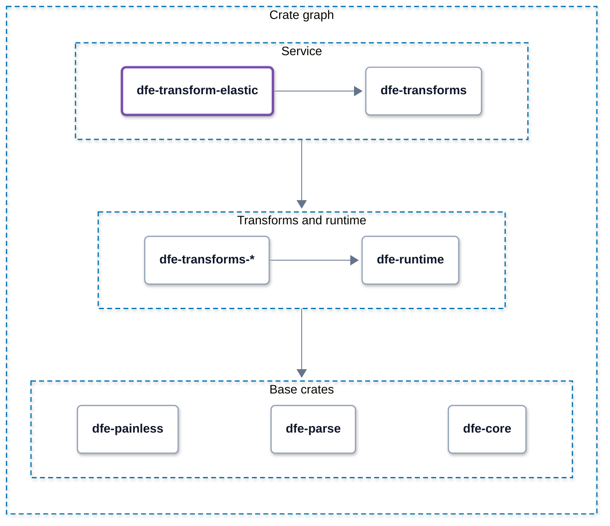

# Contributing

We welcome contributions to this project. By contributing, you agree to the
terms outlined below.

## Commit Message Format

HyperI projects use [Conventional Commits](https://www.conventionalcommits.org/)
and [semantic-release](https://semantic-release.gitbook.io/) for automated
versioning and changelog generation. All commits must follow this format:

```text
<type>(<scope>): <subject>

[optional body]

[optional footer(s)]
```

The type sets the version bump:

| Type | Description | Version Bump |
|------|-------------|--------------|
| `feat` | A new feature | Minor (0.X.0) |
| `fix` | A bug fix | Patch (0.0.X) |
| `docs` | Documentation only | None |
| `style` | Code style (formatting, semicolons, etc.) | None |
| `refactor` | Code change that neither fixes a bug nor adds a feature | None |
| `perf` | Performance improvement | Patch (0.0.X) |
| `test` | Adding or correcting tests | None |
| `build` | Changes to build system or dependencies | None |
| `ci` | Changes to CI configuration | None |
| `chore` | Other changes that don't modify src or test files | None |
| `revert` | Reverts a previous commit | Varies |

For breaking changes that require a major version bump, add `!` after the type
or include `BREAKING CHANGE:` in the footer:

```text
feat!: remove deprecated API endpoints

BREAKING CHANGE: The /v1/users endpoint has been removed. Use /v2/users instead.
```

Examples:

```text
feat(auth): add OAuth2 support for Google login

fix(api): handle null response from upstream service

docs: update installation instructions for Windows

refactor(core)!: restructure module exports

BREAKING CHANGE: Named exports are now used instead of default exports.
```

Scope is optional but recommended. Use it to indicate the area of the codebase
affected (e.g., `api`, `auth`, `core`, `cli`, `docs`).

This project follows [Semantic Versioning 2.0.0](https://semver.org/):

- MAJOR (X.0.0): breaking changes that need users to modify their code
- MINOR (0.X.0): backwards-compatible features
- PATCH (0.0.X): bug fixes and small improvements

Versions are automatically determined by semantic-release based on commit
messages. Do not manually update version numbers.

## License for Contributions

All contributions to this project are licensed under the Business Source
License 1.1 (BUSL-1.1), the same license that covers the project.

Each version of the software (including your contributions) will automatically
become available under the Apache License, Version 2.0 on the third
anniversary of its release.

## How to Contribute

1. Fork the repository and create your branch from `main`.
2. Make your changes, following the commit message format above.
3. Run the tests below.
4. Open a pull request that says what the change does.

A question goes in an issue.

Before you open it, check:

- [ ] Commits follow the conventional commit format
- [ ] Tests pass (if applicable)
- [ ] Documentation is updated (if applicable)

## CI/CD Workflow

A pull request runs the quality and test jobs. Merging to `main` does not release. A release is a merge with a `Publish: true` trailer in its commit, or a `hyperi-ci publish` dispatch, and semantic-release then picks the version from the commit types since the last release, updates the CHANGELOG, and creates the GitHub release with the image.

## CI is slow here, so iterate off it

**A push to find out what CI says costs the better part of an hour.** Treat CI
as the gate that proves a finished change, never as the type checker.

Per release run on this repo:

| Stage | Elapsed |
|---|---|
| Quality | ~18 min warm, ~40 after a lockfile change |
| Build, linux-amd64 | ~30 min plain, 93 min with PGO |
| Build, linux-arm64 | ~6-16% longer again than amd64 |

The PGO figure is from a run, not a projection: instrument build, then 300
seconds of load against each of two sources, then the optimise build.

The cause is this repo's size rather than a misconfiguration. `dfe-transforms`
has one module per data stream, over a thousand of them across about 2,200
source files, split into crates by package so each `rustc` peaks near 14 GiB
whatever `-j` says, and the binary then links under thin LTO with one codegen
unit. Neither step spreads well across cores, which is why a bigger runner buys
very little.

**PGO and BOLT are both on for the release build** (`.hyperi-ci.yaml`). PGO alone is two cargo passes around 600
seconds of load. BOLT adds two more passes and
another workload, and retries the pair on a failure, so the two together are
roughly two hours per architecture and three with a retry.

That cost falls on a release, never on a PR, because the build half runs
behind the `Publish: true` trailer or a `hyperi-ci publish` dispatch.

Everything below runs locally. `hyperi-ci check` takes about an hour and runs
the same gates CI does, and the rest answer in seconds:

```bash
# The same gates CI runs, before pushing.
hyperi-ci check

# The floors over the committed samples.
cargo test -p dfe-transforms --test integration --test untested_sources --test unencumbered
```

Keep a `bacon` session running as you edit. It recompiles on save and gives
verdicts without spending a CI run on them. The first build of the workspace
is cold and takes around twenty minutes, and every one after it is incremental.

Two traps worth knowing before you burn a run on them:

- **Never set `CARGO_BUILD_JOBS` by hand.** A hand-set value beats the project's
  pinning and any build governor on the host.
- **`tests/fixtures/` holds `unencumbered/` and `synthetic/` and nothing else.** `unencumbered.rs` fails a tree holding anything more, or any file with one of its marker strings.

## Crates and modules

The workspace holds five library crates, the generated transform crates, the PGO workload driver and the root service package.

Every generated transform crate builds on `dfe-runtime`, which builds on the three base crates.



*Figure 1. L4 Detail -- Crate dependencies.* Up: [L3 Components -- dfe-transform-elastic](docs/architecture.md).

The service and `dfe-transforms` depend on `dfe-runtime` directly as well, and `dfe-painless` depends on `dfe-core`. The diagram leaves those edges out.

| Crate | Purpose |
|---|---|
| `dfe-transform-elastic` | The service, module by module in the next table |
| `dfe-transforms` | One module per source pipeline (`filebeat::<package>::<pipeline>`), re-exported from the generated crates |
| `dfe-transforms-<first>-<last>` | The generated filebeat modules for a contiguous run of packages, compiled from `crates/dfe-transforms/src/filebeat` so no single rustc holds the whole tree |
| `dfe-runtime` | Grok caching, enrichment, `codegen_api`, the `Transform` trait and the prelude |
| `dfe-painless` | Painless matching: the `known_patterns` ladder, `plan`, `params`, `patterns.lock`, and `bespoke/`, one module per source of hand-written runners resolved by script hash ahead of every matcher |
| `dfe-core` | `Event`, error types, date formats, syslog priority and the regex cache |
| `dfe-parse` | Zero-copy parsers that replace grok and regex patterns |
| `pgo-driver` | The PGO workload driver, built apart so the workload's build never rebuilds the transforms |

The generated transforms reach the Painless matchers through `dfe-runtime`, which re-exports the moved modules at their old `painless_*` paths. Code written against these crates names the crate that holds the code.

`grok_cache` sends two whole-pattern IPv4 forms to `dfe-parse` and answers a lone `%{GREEDYDATA}` with a newline scan. Every other pattern runs on its compiled regex ([docs/parsers.md](docs/parsers.md)). The third-party libraries are in [Key dependencies](docs/performance.md#key-dependencies).

`src/` resolves the configured source name to one compiled transform and runs it over every batch on the scalo runtime, over the bus (Kafka) or the direct (gRPC push) transport.

| Module | Responsibility |
|---|---|
| `main.rs` | Entry point, hands off to `cli.rs` |
| `cli.rs` | Subcommands: `sources`, `emit-dockerfile`, `emit-compose`, `emit-config` and `emit-catalogue`, plus scalo's `run`, `version`, `config-check`, `config-schema`, `generate-artefacts` and `metrics-manifest` |
| `config.rs` | The config fields: `source.*`, `sink.*` and `geoip`, read once at startup, and `work_state`, which decides whether an instance has work or idles. Also `Transport`, the `bus`/`direct` selector on each side |
| `config/loader.rs` | Loading, from the scalo cascade or an explicit `--config` file, and `SCALO_SECTIONS`, the sections scalo reads for itself, which the unread-key warning skips |
| `config/validate.rs` | Rejecting a configuration that cannot work. The range checks run ahead of the idle gate, so an out-of-range value fails even on an instance with no work |
| `registry.rs` | Source name to `Transform`, plus each source's `Intake` (the envelopes it accepts), `Framing` and dataset |
| `envelope.rs` | Detects which of the three producer families wrapped an event and unwraps it into the bare event every transform expects |
| `agentless.rs`, `detect/` | Agentless mode: names each event's source from the marker table, runs that source's transform and stamps `_source` |
| `pipeline.rs` | Batch processing: NDJSON parse, envelope unwrap, transform, serialise, with per-batch outcome counts |
| `service.rs` | Runs `pipeline.rs` on scalo's `BatchEngine` between the scalo consumer and producer, Kafka on the bus and a Push listener and gRPC client on direct, and maps what the sink answers onto the delivery rules below |
| `deployment.rs` | The deployment contract the Dockerfile, chart, compose fragment and KEDA scaler come from. Its tests pin some of the generated artefacts, [Generated artefacts](#generated-artefacts) says which |
| `metrics.rs` | Metric definitions registered with scalo's `MetricsManager` |
| `error.rs` | The service's top-level error type |

Nothing is hot-reloaded, `--config` and the scalo cascade are not equivalent, and one env spelling reaches a `--config` file. [docs/configuration.md](docs/configuration.md) covers all three.

## Working in this repo

```bash
cargo test --workspace --all-features
hyperi-ci check
```

`librdkafka` 2.12.1 or later is needed for the `kafka` feature, which is on by default. `cargo build --no-default-features` builds without it.

Non-English text is a tested case, not an edge case. `tests/unicode.rs` runs every registered transform against seventeen samples of scripts, combining marks, emoji and degenerate inputs.

### Generated artefacts

The container image, compose fragment and released chart are all generated from one deployment contract in `src/deployment.rs`:

```bash
dfe-transform-elastic emit-dockerfile > Dockerfile
dfe-transform-elastic emit-compose
dfe-transform-elastic generate-artefacts --output-dir docs
```

`generate-artefacts` writes into `docs/`: `metrics-manifest.json`, `deployment-contract.json`, `container-manifest.json`, `Dockerfile.runtime`, and the reflectable config pair `config-schema.*` and `capability-catalog.*`.

The deployed chart is not committed here. At release, hyperi-ci runs `generate-artefacts` for the deployment contract and assembles a thin chart from it on the scalo-service library chart, at the version `release.helm.library` names in `.hyperi-ci.yaml`. Keep that version at the scalo version in `Cargo.toml`: a library renders only the contract version its scalo release writes.

**Not every artefact is pinned against a fresh regen.** `committed_config_artefacts_do_not_drift` in `src/deployment.rs` compares `config-schema.{json,yaml}` and `capability-catalog.{json,yaml}`, and its sibling tests do the same for the committed `deployment-contract.json`, `Dockerfile` and `config.example.yaml`. Nothing compares `container-manifest.json` or `Dockerfile.runtime`, so those can and do fall behind -- re-run the command when `src/deployment.rs` changes rather than assuming a test caught it.

`metrics-manifest.json` is compared by metric NAME SET in `src/metrics.rs`, not byte for byte, because it records the version and commit of the build that wrote it.

The image expects the release binary in the build context:

```bash
cargo build --release
cp target/release/dfe-transform-elastic .
docker build -t dfe-transform-elastic .
```

### The catalogue and the detect tables

`sources.yaml` is the source catalogue: every source this service transforms, and what its name does not say. The registry is asserted against it, and `dfe-transform-elastic emit-catalogue` prints the copy compiled into the binary, which dfe-engine offers as its source catalogue. Per source:

| Key | Holds |
|---|---|
| `package` | The integration package directory |
| `data_stream` | The data stream directory within that package |
| `pipelines` | Where the source's pipelines sit in the pipeline tree |
| `fixtures` | The source's fixture directory |
| `beats` | The Beats module and fileset for the same source, if any |
| `intakes` | Every way the payload can arrive: `beats` always, `receiver` when a device pushes it, `fetcher` when Elastic's agent input is a pure transport such as `httpjson`, `cel` or `aws-s3` |
| `framing` | Receiver intakes only: `line` if the pipeline groks the syslog header out of `message`, `body` if a header would corrupt its first field |
| `transforms` | The generated transforms wired into the registry, as `filebeat.<source>.<transform>` |

None of it is derivable from the name: fortinet's package is `fortinet_fortigate`, and one azure package is four of our modules.

`scripts/emit_variants.py` prints every registered variant with the intakes it accepts. On a push to `main` that changes it, `.github/workflows/sync-elastic-variants.yml` opens or updates a `chore(elastic-variants)` PR on dfe-schemas, and its catalogue test checks every elastic entry against that file.

The other direction is generated code. `src/detect/labels.rs` (each variant's `_source` label) and `src/detect/markers.rs` (the agentless marker table) come from the dfe-schemas wheel `scripts/dfe-schemas.toml` pins by version and sha256. To move the pin, set both values from `https://pypi.org/pypi/dfe-schemas/<version>/json` and run `scripts/gen_detect_tables.py`. `tests/scripts_suite.rs` runs it with `--check`, so a stale file fails the test job.
