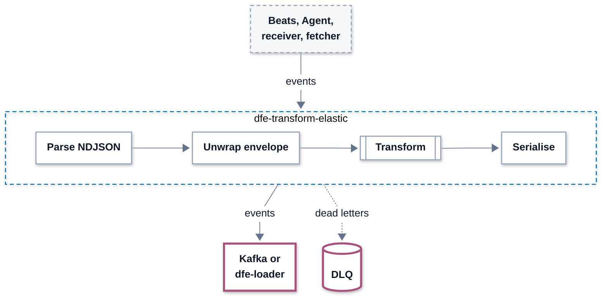
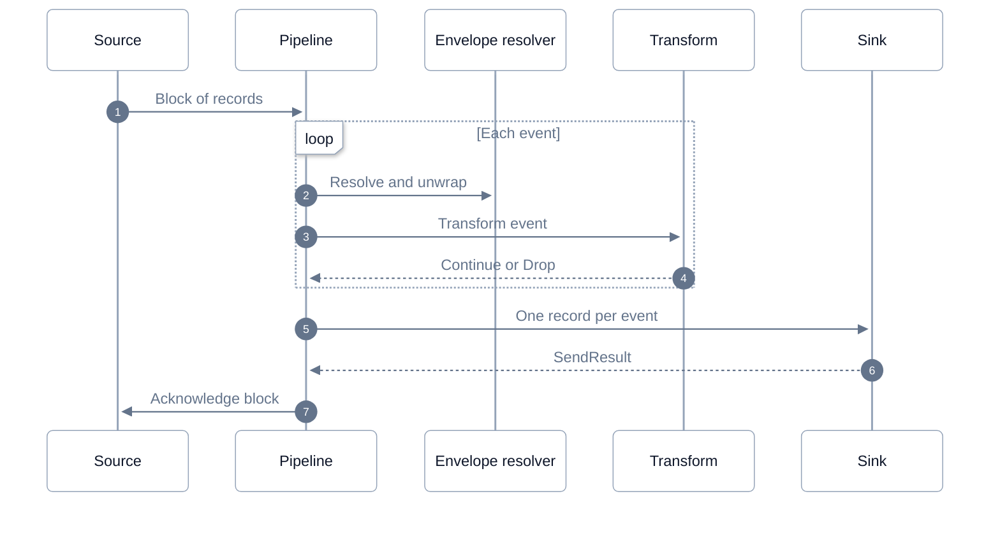
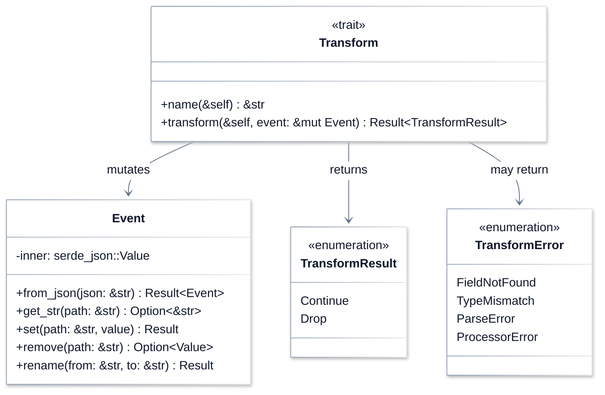

# Architecture

dfe-transform-elastic applies a source's Elastic ingest pipeline to each event as compiled Rust. The service resolves the configured source name to one generated transform at startup, so there is no interpreter, scripting VM or plugin system, and no lookup per event.

This page is the code map: the parts of the service, the crates, the modules, the envelopes, delivery, and what an event is on the way through. [parity.md](parity.md), [parsers.md](parsers.md), [enrichment.md](enrichment.md), [testing.md](testing.md) and [performance.md](performance.md) cover the rest.

## Four steps between the producers and the sink

Each batch is parsed, unwrapped, transformed and serialised in that order, and dead letters leave for the DLQ.



*Figure 1. L3 Components -- dfe-transform-elastic. Dashed boxes are external and the dotted arrow is the dead-letter path.* Up: top of dfe-transform-elastic. Down: [L4 Detail -- A failed processor](#a-failed-processor-ends-in-one-of-four-places).

Events arrive from Kafka or over a direct gRPC push, in any of three producer envelopes, and leave the same way. Input that is not JSON, and a record the sink transport would reject, go to the DLQ. In agentless mode a detector picks the transform per event ([configuration.md](configuration.md#agentless-mode-serves-one-syslog-stream-of-many-device-types)).

## Crates and modules

The workspace holds five library crates, the generated transform crates, the PGO workload driver and the root service package.

Every generated transform crate builds on `dfe-runtime`, which builds on the three base crates.

```mermaid
---
config:
  theme: base
  look: neo
  fontFamily: Inter, -apple-system, Segoe UI, Roboto, Helvetica, Arial, sans-serif
  flowchart:
    curve: linear
    nodeSpacing: 40
    rankSpacing: 64
    padding: 18
    wrappingWidth: 280
    htmlLabels: true
  elk:
    preset: modelOrder
  themeVariables:
    fontSize: 15px
    lineColor: "#64748B"
    primaryTextColor: "#0F172A"
    clusterBorder: "#0072B2"
    edgeLabelBackground: "#FFFFFF"
  themeCSS: >-
    p{margin:0}
    .node[data-look] rect,.node[data-look] path,.node[data-look] polygon,.node[data-look] .outer-path{filter:drop-shadow(0 1px 2px rgba(15,23,42,.10)) drop-shadow(0 6px 14px rgba(15,23,42,.10))}
    .node rect{rx:10px;ry:10px}
    .cluster rect{rx:16px;ry:16px}
    .node .label div{min-width:150px}
    .node.decision .label div{min-width:0}
    .cluster[data-look] rect{filter:none}
    .nodeLabel{line-height:1.35}
    .nodeLabel b{font-weight:600;font-size:15px;letter-spacing:-0.01em}
    .nodeLabel span{font-size:12.5px;font-weight:400;color:#334155}
    .cluster-label span.nodeLabel{display:inline-block;background:#FFFFFF;color:#0B2A3F;border:1.5px solid #0072B2;border-radius:999px;padding:2px 12px;font-size:11.5px;font-weight:700;letter-spacing:.09em;text-transform:uppercase}
    .flowchart-link{stroke-width:1.75px}
    .labelBkg{background:transparent!important}
    span.edgeLabel{display:inline-block;background:#FFFFFF!important;color:#1E293B;border:1px solid #94A3B8;border-radius:999px;padding:2px 10px;font-size:12px;font-weight:500}
    span.edgeLabel p{background:transparent!important}
    .label-icon{width:20px;height:20px;vertical-align:-4px;margin-right:6px}
    .ingest .label-icon{color:#0E8A7D}
    .xform .label-icon{color:#7B4FB0}
    .load .label-icon{color:#0072B2}
    .bus .label-icon{color:#A8517F}
    .store .label-icon{color:#00785A}
    .ui .label-icon{color:#D9480F}
    .ext .label-icon{color:#64748B}
---
flowchart LR
    accTitle: L4 Detail -- Crate dependencies
    accDescr: The service depends on dfe-transforms, which re-exports the generated transform crates. They depend on dfe-runtime, which depends on dfe-painless, dfe-parse and dfe-core.

    service["<b>dfe-transform-elastic</b>"]
    transforms["<b>dfe-transforms</b>"]
    generated["<b>dfe-transforms-*</b>"]
    runtime["<b>dfe-runtime</b>"]

    subgraph base["Base crates"]
        painless["<b>dfe-painless</b>"]
        parse["<b>dfe-parse</b>"]
        core["<b>dfe-core</b>"]
    end

    service --> transforms
    transforms --> generated
    generated --> runtime
    runtime --> base
  classDef ext fill:#F4F6F8,stroke:#94A3B8,stroke-width:1.5px,stroke-dasharray:5 4,color:#0F172A
  classDef ingest fill:#FFFFFF,stroke:#0E8A7D,stroke-width:3px,color:#0F172A
  classDef xform fill:#FFFFFF,stroke:#7B4FB0,stroke-width:3px,color:#0F172A
  classDef load fill:#FFFFFF,stroke:#0072B2,stroke-width:3px,color:#0F172A
  classDef bus fill:#FFFFFF,stroke:#A8517F,stroke-width:3px,color:#0F172A
  classDef store fill:#FFFFFF,stroke:#00785A,stroke-width:3px,color:#0F172A
  classDef ui fill:#FFFFFF,stroke:#D9480F,stroke-width:3px,color:#0F172A
  classDef decision fill:#FFFFFF,stroke:#9A6700,stroke-width:3px,color:#0F172A
  classDef error fill:#FFFFFF,stroke:#C2410C,stroke-width:3px,color:#0F172A
  classDef control fill:#FFFFFF,stroke:#334155,stroke-width:3px,color:#0F172A
  classDef part fill:#FFFFFF,stroke:#94A3B8,stroke-width:1.5px,color:#0F172A
  class service xform
  class transforms,generated,runtime,painless,parse,core part
  style base fill:none,stroke:#0072B2,stroke-width:1.5px,stroke-dasharray:6 4
```



*Figure 2. L4 Detail -- Crate dependencies.* Up: [L3 Components -- dfe-transform-elastic](#four-steps-between-the-producers-and-the-sink).

The service and `dfe-transforms` depend on `dfe-runtime` directly as well, and `dfe-painless` depends on `dfe-core`. The diagram leaves those edges out to keep each arrow one column long.

| Crate | Purpose |
|---|---|
| `dfe-transform-elastic` | The service, module by module in the next table |
| `dfe-transforms` | One module per source pipeline (`filebeat::<package>::<pipeline>`), re-exported from the generated crates |
| `dfe-transforms-<first>-<last>` | The generated filebeat modules for a contiguous run of packages, compiled from `crates/dfe-transforms/src/filebeat` so no single rustc holds the whole tree |
| `dfe-runtime` | Grok caching, enrichment, `codegen_api`, the `Transform` trait and the prelude |
| `dfe-painless` | Painless matching: the `known_patterns` ladder, `plan`, `params`, `patterns.lock`, and `bespoke/`, one module per source of hand-written runners resolved by script hash ahead of every matcher |
| `dfe-core` | `Event`, error types, date formats, syslog priority and the regex cache |
| `dfe-parse` | Zero-copy parsers that replace grok and regex patterns |
| `pgo-driver` | The PGO workload driver, built apart so the workload's build never rebuilds the transforms |

The generated transforms reach the Painless matchers through `dfe-runtime`, which re-exports the moved modules at their old `painless_*` paths. Code written against these crates names the crate that holds the code.

`grok_cache` sends two whole-pattern IPv4 forms to `dfe-parse` and answers a lone `%{GREEDYDATA}` with a newline scan. Every other pattern runs on its compiled regex ([parsers.md](parsers.md)). The third-party libraries are in [Key dependencies](performance.md#key-dependencies).

`src/` resolves the configured source name to one compiled transform and runs it over every batch on the scalo runtime, over the bus (Kafka) or the direct (gRPC push) transport.

| Module | Responsibility |
|---|---|
| `main.rs` | Entry point, hands off to `cli.rs` |
| `cli.rs` | Subcommands: `sources`, `emit-dockerfile`, `emit-compose`, `emit-config` and `emit-catalogue`, plus scalo's `run`, `version`, `config-check`, `config-schema`, `generate-artefacts` and `metrics-manifest` |
| `config.rs` | The config fields: `source.*`, `sink.*` and `geoip`, read once at startup, and `work_state`, which decides whether an instance has work or idles. Also `Transport`, the `bus`/`direct` selector on each side |
| `config/loader.rs` | Loading, from the scalo cascade or an explicit `--config` file, and `SCALO_SECTIONS`, the sections scalo reads for itself, which the unread-key warning skips |
| `config/validate.rs` | Rejecting a configuration that cannot work. The range checks run ahead of the idle gate, so an out-of-range value fails even on an instance with no work |
| `registry.rs` | Source name to `Transform`, plus each source's `Intake` (the envelopes it accepts), `Framing` and dataset |
| `envelope.rs` | Detects which of the three producer families wrapped an event and unwraps it into the bare event every transform expects |
| `agentless.rs`, `detect/` | Agentless mode: names each event's source from the marker table, runs that source's transform and stamps `_source` |
| `pipeline.rs` | Batch processing: NDJSON parse, envelope unwrap, transform, serialise, with per-batch outcome counts |
| `service.rs` | Runs `pipeline.rs` on scalo's `BatchEngine` between the scalo consumer and producer, Kafka on the bus and a Push listener and gRPC client on direct, and maps what the sink answers onto the delivery rules below |
| `deployment.rs` | The deployment contract the Dockerfile, chart, compose fragment and KEDA scaler come from. Its tests pin some of the generated artefacts, [CONTRIBUTING.md](../CONTRIBUTING.md#generated-artefacts) says which |
| `metrics.rs` | Metric definitions registered with scalo's `MetricsManager` |
| `error.rs` | The service's top-level error type |

Nothing is hot-reloaded, `--config` and the scalo cascade are not equivalent, and one env spelling reaches a `--config` file. [configuration.md](configuration.md) covers all three.

## Envelopes: the same transform, a different wrapper

`source.envelope` is `auto` (the default), `beats`, `receiver` or `fetcher`.

- `beats` -- the raw payload as a string in `message`. The transforms are written for this, and Elastic Agent and anything passing a Beats document through unaltered produce it.
- `receiver` -- [dfe-receiver](https://github.com/hyperi-io/dfe-receiver)'s JSON on any of its transports. The syslog arm rebuilds a line into `message`, and the rest pass their payload through with the receiver's field names moved onto the ECS paths they would shadow.
- `fetcher` -- [dfe-fetcher](https://github.com/hyperi-io/dfe-fetcher)'s JSON, the provider's payload at the top level, for sources where Elastic's agent input is a pure transport.

`auto` resolves the family per event. A scalo `WorkBatch` spans partitions, so one batch can hold two producers' wrappers. The cost is a few top-level key checks, against an unwrap that cost 2,740 ns an event when benchmarked.

A bare payload with no producer marker is the one quiet failure. Detection falls back to `beats`, there is no `message` to unpack, and the transform runs and emits with almost nothing renamed. Output that looks like the input with an `ecs.version` added is this.

`registry.rs` records a syslog framing for every source the receiver can deliver:

- `Body` sources, such as `panw` and `cisco_meraki`, read `message` as CSV or key-value, so the body goes through with no header. A tagless PAN-OS line arrives with its first CSV field in `appname`, and when that is not a valid tag the body is rebuilt from `appname`, `procid` and `message`.
- `Line` sources, such as `fortinet`, `cisco_ios` and `cisco_nexus`, grok the header out of `message`. The line is the receiver's opt-in `_raw` where present, else an RFC 3164 line rebuilt from the parsed fields. That is enough for `fortinet`, which wants `<PRI>`, and not for `cisco_ios` or `cisco_nexus`, which want a source IP and a sequence number the receiver does not keep.

A pinned envelope a source cannot arrive in is rejected at startup against the source's `Intake`. okta is pulled from an API, so it accepts `beats` and `fetcher` and rejects `receiver`. `auto` has no event to check at startup, so the same mismatch is counted per batch on `envelope_unaccepted_total`.

## Delivery is at least once

The loop is scalo's `BatchEngine` (`service.rs::run_loop`). It holds each block's source acknowledgement, the Kafka offset commit on the bus or the answer to a push on direct, until the sink has taken every event built from it. `source.acknowledgements.enabled: false` releases it at receipt, and a crash then loses what was in flight.

When the sink answers `Backpressured`, the block is held and retried until the sink takes it, and nothing after it is committed. A failure no retry can fix stops the loop with the block unreleased, so the restarted consumer reads it again. The direct listener holds pushes from the moment it binds, so a push that lands before the loop starts waits for delivery rather than being answered on arrival.

A push is held at most 18 s (`PUSH_MAX_HOLD`), inside the 20 s the stage in front waits, and the bytes held are leased on the memory guard. Every send a held block waits on gives up at 15 s (`NEXT_HOP_SEND_TIMEOUT_MS`): a direct sink's gRPC deadline, and on the bus the producer's `message.timeout.ms` when a direct source holds its pushes. A send that outlasted the hold would land after the push was answered `unavailable`, and its retry would be a duplicate.

Duplicates are the accepted cost: a retried block re-sends the records that landed, so every consumer downstream must be idempotent.

The sink's answer decides what happens to the block:

| `SendResult` | Meaning | Response |
|---|---|---|
| `Ok` | The sink took it | Counted delivered |
| `Backpressured` | A full producer queue, or a broker or listener out of reach | Retried until the sink takes it |
| `Fatal` | A timeout is retried like `Backpressured`. Anything else, such as authorisation, a missing topic or a closed transport, is not | Stop, block unreleased |
| `FilteredDlq` | The sink transport dead-lettered the send | Dropped, counted on `send_filtered_dlq_total` and `records_filtered_total`, block released, never counted delivered |

A record the sink transport would reject, over its `message.max.bytes` or matched by an outbound `dlq` filter, is screened out before the send. Input that is not JSON is a dead letter with the reason `payload is not JSON`: the whole record when no line parses, else the bad line. Both go to the DLQ `dlq` configures, a file DLQ by default, and the block is released once the DLQ holds them. With `dlq.enabled: false` they are dropped and counted on `pipeline_dead_letters_dropped_total{reason}` and `dlq_dropped_total`.

Each event goes out as a separate record. `pipeline.rs::serialise_events_with_oversize` gives each one a payload, and `service.rs::send_blocks` sends them in blocks through `TransportSender::send_batch`, because dfe-loader parses one JSON document per message ([#67](https://github.com/hyperi-io/dfe-transform-elastic/issues/67)). `sink.max_message_bytes`, 8,000,000 bytes by default, bounds each payload under the 16 MiB producer ceiling and each block under gRPC's 16 MiB. An event over the budget goes to the DLQ, with its size and the budget as the reason, and is counted on `events_oversize_total`. No broker would take it, and retrying would block the partition.

## One batch through the service

With `source.acknowledgements` on, the default, the source is acknowledged after the sink takes the batch.



*Figure 3. L4 Detail -- One batch through the service. Solid arrows are requests, dashed arrows are responses.* Up: [L3 Components -- dfe-transform-elastic](#four-steps-between-the-producers-and-the-sink).

JSON is the one payload format. A MessagePack record, which DFE/XDR 2.0 and 2.1 accepted, is a dead letter like any other binary.

An event that fails to unwrap or transform is counted on `events_errored_total` and left out of the output, and the batch continues. A transform that returns `Continue` has its `event.original` settled as [parity.md](parity.md) describes.

## Event model

`Event` in `dfe-core` wraps a `serde_json::Value` with dotted-path access for ECS fields.

A transform mutates an `Event` in place and returns `Continue`, `Drop` or an error.



*Figure 4. L4 Detail -- Event and Transform types. The enumerations list the main variants, not all of them.* Up: [L3 Components -- dfe-transform-elastic](#four-steps-between-the-producers-and-the-sink).

`set()` creates intermediate objects. A read of a segment that is not a field falls back to a key with the dot inside it, and a numeric segment indexes an array, the way Elastic's templates read `{{_temp.user_parts.0}}`.

```rust
// Reads {"source": {"geo": {"city_name": ...}}}
event.get_str("source.geo.city_name")

// Creates {"source": {"geo": {}}} if missing, then sets city_name
event.set("source.geo.city_name", "Sydney")?;
```

- The map under `serde_json::Value` is an `IndexMap`, because `preserve_order` is on: Elasticsearch's ingest documents keep insertion order and parity rests on it.
- `Event::from_bytes` parses with `serde_json`, not simd-json. Getting a `serde_json::Value` out of simd-json builds two trees for one document, and `crates/dfe-runtime/benches/json_parse.rs` shows it slower. simd-json stays a dev-dependency of `dfe-runtime` for that bench.

## A failed processor ends in one of four places

A generated transform is one function that runs its pipeline's processors in order, each behind its `if` condition. The `Transform` trait is object-safe, and the registry hands out `&'static dyn Transform`.

A failed processor is skipped, handled, or ends the pipeline, and the event is lost when the pipeline has no handler.

```mermaid
---
config:
  theme: base
  look: neo
  fontFamily: Inter, -apple-system, Segoe UI, Roboto, Helvetica, Arial, sans-serif
  flowchart:
    curve: linear
    nodeSpacing: 40
    rankSpacing: 64
    padding: 18
    wrappingWidth: 280
    htmlLabels: true
  elk:
    preset: modelOrder
  themeVariables:
    fontSize: 15px
    lineColor: "#64748B"
    primaryTextColor: "#0F172A"
    clusterBorder: "#0072B2"
    edgeLabelBackground: "#FFFFFF"
  themeCSS: >-
    p{margin:0}
    .node[data-look] rect,.node[data-look] path,.node[data-look] polygon,.node[data-look] .outer-path{filter:drop-shadow(0 1px 2px rgba(15,23,42,.10)) drop-shadow(0 6px 14px rgba(15,23,42,.10))}
    .node rect{rx:10px;ry:10px}
    .cluster rect{rx:16px;ry:16px}
    .node .label div{min-width:150px}
    .node.decision .label div{min-width:0}
    .cluster[data-look] rect{filter:none}
    .nodeLabel{line-height:1.35}
    .nodeLabel b{font-weight:600;font-size:15px;letter-spacing:-0.01em}
    .nodeLabel span{font-size:12.5px;font-weight:400;color:#334155}
    .cluster-label span.nodeLabel{display:inline-block;background:#FFFFFF;color:#0B2A3F;border:1.5px solid #0072B2;border-radius:999px;padding:2px 12px;font-size:11.5px;font-weight:700;letter-spacing:.09em;text-transform:uppercase}
    .flowchart-link{stroke-width:1.75px}
    .labelBkg{background:transparent!important}
    span.edgeLabel{display:inline-block;background:#FFFFFF!important;color:#1E293B;border:1px solid #94A3B8;border-radius:999px;padding:2px 10px;font-size:12px;font-weight:500}
    span.edgeLabel p{background:transparent!important}
    .label-icon{width:20px;height:20px;vertical-align:-4px;margin-right:6px}
    .ingest .label-icon{color:#0E8A7D}
    .xform .label-icon{color:#7B4FB0}
    .load .label-icon{color:#0072B2}
    .bus .label-icon{color:#A8517F}
    .store .label-icon{color:#00785A}
    .ui .label-icon{color:#D9480F}
    .ext .label-icon{color:#64748B}
---
flowchart LR
    accTitle: L4 Detail -- A failed processor
    accDescr: A failed processor with ignore_failure set is skipped. Otherwise the processor's on_failure handlers run if it has any. Failing that, the pipeline's on_failure handlers run and keep the event, and with none the event is dropped and counted.

    ignore{"<b>ignore_failure<br/>set?</b>"}
    skip(["<b>Next processor</b>"])
    proc{"<b>Processor's<br/>on_failure?</b>"}
    handlers(["<b>Its handlers run</b>"])
    pipe{"<b>Pipeline<br/>on_failure?</b>"}
    kept(["<b>Pipeline handlers<br/>run, event kept</b>"])
    dropped(["<b>Dropped and<br/>counted</b>"])

    ignore -->|yes| skip
    ignore -->|no| proc
    proc -->|yes| handlers
    proc -->|no| pipe
    pipe -->|yes| kept
    pipe -->|no| dropped
  classDef ext fill:#F4F6F8,stroke:#94A3B8,stroke-width:1.5px,stroke-dasharray:5 4,color:#0F172A
  classDef ingest fill:#FFFFFF,stroke:#0E8A7D,stroke-width:3px,color:#0F172A
  classDef xform fill:#FFFFFF,stroke:#7B4FB0,stroke-width:3px,color:#0F172A
  classDef load fill:#FFFFFF,stroke:#0072B2,stroke-width:3px,color:#0F172A
  classDef bus fill:#FFFFFF,stroke:#A8517F,stroke-width:3px,color:#0F172A
  classDef store fill:#FFFFFF,stroke:#00785A,stroke-width:3px,color:#0F172A
  classDef ui fill:#FFFFFF,stroke:#D9480F,stroke-width:3px,color:#0F172A
  classDef decision fill:#FFFFFF,stroke:#9A6700,stroke-width:3px,color:#0F172A
  classDef error fill:#FFFFFF,stroke:#C2410C,stroke-width:3px,color:#0F172A
  classDef control fill:#FFFFFF,stroke:#334155,stroke-width:3px,color:#0F172A
  classDef part fill:#FFFFFF,stroke:#94A3B8,stroke-width:1.5px,color:#0F172A
  class ignore,proc,pipe decision
  class skip,handlers,kept part
  class dropped error
```



*Figure 5. L4 Detail -- A failed processor. Orange is the event lost to the output.* Up: [L3 Components -- dfe-transform-elastic](#four-steps-between-the-producers-and-the-sink).

| Elastic behaviour | Generated Rust |
|---|---|
| `if` | The processor runs inside `if _cond { ... }` |
| `ignore_failure: true` | The processor runs in a closure whose error is discarded |
| A processor's `on_failure` | Its handlers run with `_ingest.on_failure_message`, `_ingest.on_failure_processor_type` and `_ingest.on_failure_processor_tag` set, then cleared |
| The pipeline's `on_failure` | Its handlers run, and the event is emitted |
| No handler at all | The error leaves the transform, and `pipeline.rs` drops the event and counts it on `events_errored_total` |
| `drop` | The transform returns `TransformResult::Drop` |

Most Elastic pipelines declare a pipeline-level `on_failure` that sets `event.kind: pipeline_error`, appends to `error.message` and tags `preserve_original_event`, so the generated transform does the same.
