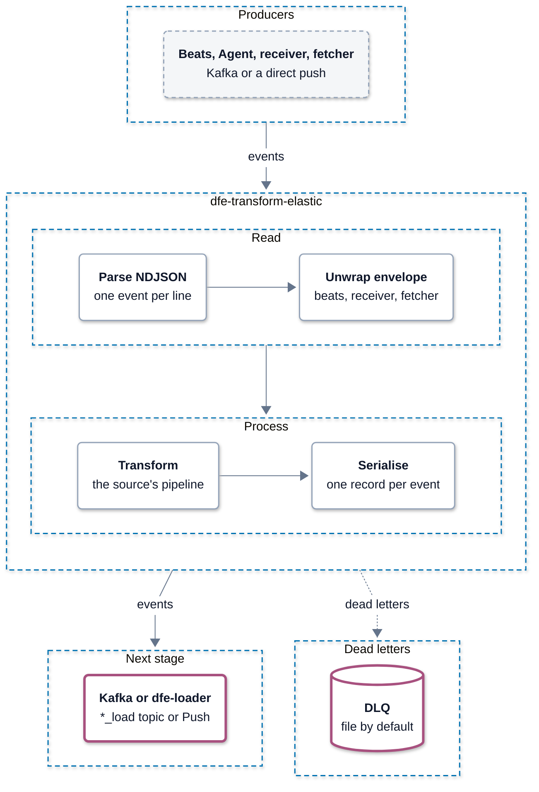

# dfe-transform-elastic architecture

dfe-transform-elastic turns Beats and Elastic Agent events into DFE-normalised events, applying each source's Elastic ingest pipeline as compiled Rust. It sits between a source's land topic and dfe-loader, so an existing Elastic shipper lands in DFE unchanged.

*Figure 1. L3 Components -- dfe-transform-elastic. Dashed boxes are outside DFE, and the dotted arrow is the dead-letter path.* Up: [L2 Services -- DFE deployment](https://github.com/hyperi-io/dfe-infra/blob/main/docs/architecture.md). Down: [L4 Detail -- Unwrap envelope](envelopes.md), [L4 Detail -- Transform](transform.md), [L4 Detail -- One batch through the service](delivery.md#how-it-works).

## How data flows

1. A block arrives from Kafka or a Push listener on port 6000. Parse NDJSON splits it into events. A line that isn't JSON is a dead letter.
2. Unwrap envelope reads which producer wrapped each event and unwraps it into the bare event the transforms expect.
3. Transform runs the source's generated pipeline, its processors in order. An event that fails with no handler is dropped and counted.
4. Serialise gives each event its own record. One over `sink.max_message_bytes` goes to the DLQ.
5. The sink takes the block, and the source is acknowledged.

The source name in the config picks one transform at startup. In agentless mode a detector picks it per event instead, for one syslog stream of many device types ([configuration.md](configuration.md#agentless-mode-serves-one-syslog-stream-of-many-device-types)).

## Components

| Part | Role | Page |
|---|---|---|
| Parse NDJSON | Splits a record into events, and dead-letters what isn't JSON | [delivery.md](delivery.md#how-it-works) |
| Unwrap envelope | Detects the producer family per event and unwraps it | [envelopes.md](envelopes.md) |
| Transform | Runs the source's Elastic pipeline as compiled Rust | [transform.md](transform.md) |
| Serialise | One record per event, under the size budget | [delivery.md](delivery.md#interfaces) |

## External dependencies

| Dependency | Needed for | Swappable |
|---|---|---|
| Kafka | The bus transport, in and out | Any broker the scalo transport reaches. Direct needs none |
| A DFE service over gRPC | The direct sink | dfe-loader or another stage's Push listener |
| Dead-letter queue | Non-JSON input and oversize records | A file DLQ by default, or Kafka, through `dlq` |
| GeoIP database (MMDB) | The `geoip` processor | Downloaded from DB-IP Lite by default, or any MMDB scalo's `geoip` config names ([enrichment.md](enrichment.md)) |

## Deployment variants

| Variant | What runs |
|---|---|
| Kubernetes `single`, `scale`, Docker `single` | On by default. dfe-engine runs one instance per source that binds an Elastic transform, and removes it once no source does |
| Other profiles | Not deployed by default |

An instance with no source name or no topics starts and idles. The chart scales on CPU, and dfe-infra's charts add the scaling-pressure composite, never raw Kafka lag. Nothing reloads: every config value needs a restart. [configuration.md](configuration.md) covers where values come from.

## Design considerations

**Security.** There is no interpreter, scripting VM or plugin system. A Painless script runs where a hand-written runner or a known pattern covers it. Anything else is skipped and counted on `painless_unhandled_total`.

**Reliability.** Delivery is at least once. The source acknowledgement is held until the sink takes every event built from a block, so a retried block re-sends what already landed, and consumers downstream must be idempotent. A failure no retry can fix stops the loop with the block unreleased.

**Operations.** Invalid UTF-8 is decoded with replacements and counted. An event that won't transform is dropped and counted, and the batch carries on. `dfe-transform-elastic sources` lists every source a build has, and a config naming one it lacks fails at startup.

**Performance.** The transform is resolved once, so there's no lookup per event. Grok runs on compiled regex, with a native path for three whole-pattern forms ([parsers.md](parsers.md)). [performance.md](performance.md) has the benchmarks.

## Why it's built this way

**Compiled, not interpreted.** Each Elastic ingest pipeline is generated into a Rust module. A pipeline change is a release, which is the trade for no per-event interpretation. For a transform that has to change without a release, use dfe-transform-vrl.

**Same output as Elastic.** The goal is the ECS output Elastic's pipeline gives for each source, scored per source ([parity.md](parity.md)). Correct beats bug-compatible ([compat-policy.md](compat-policy.md)).

**Envelope per event.** A scalo batch spans partitions, so one batch can hold two producers' wrappers. A few top-level key checks per event cost far less than the unwrap itself.

**One record per event.** dfe-loader parses one JSON document per message ([#67](https://github.com/hyperi-io/dfe-transform-elastic/issues/67)).

## Diagram map

- [Figure 1. L3 Components -- dfe-transform-elastic](architecture.md)
  - [L4 Detail -- Unwrap envelope](envelopes.md)
  - [L4 Detail -- Transform](transform.md)
    - [L4 Detail -- A failed processor](transform.md#scaling-and-failure)
    - [L4 Detail -- Event and Transform types](transform.md#interfaces)
    - [L4 Detail -- Grok dispatch](parsers.md)
    - [L4 Detail -- Enrichers](enrichment.md)
  - [L4 Detail -- One batch through the service](delivery.md)
  - [L4 Detail -- Floors and scanners](testing.md)
  - [L4 Detail -- Crate dependencies](../CONTRIBUTING.md#crates-and-modules)

## What's next

- [config.example.yaml](../config.example.yaml) and [configuration.md](configuration.md), the config and where its values come from
- [parity.md](parity.md), what the service promises against Elastic's output
- [docs/README.md](README.md), every page in this directory
- [CONTRIBUTING.md](../CONTRIBUTING.md#working-in-this-repo), the crates, the generated artefacts and the commands that test a change
