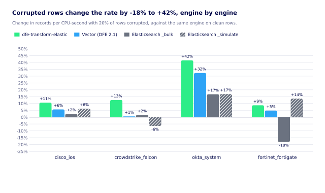
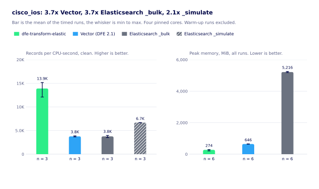
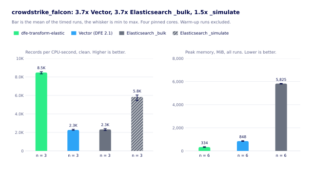
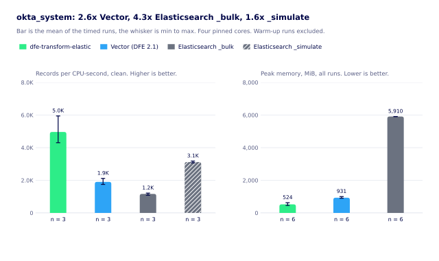
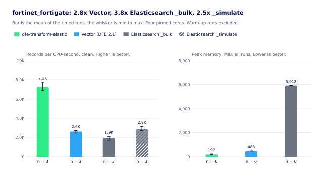

# Benchmark

How dfe-transform-elastic compares with the DFE 2.1 Vector VRL pipeline and with Elasticsearch ingest, on one corpus per source, and the numbers from the last run. The rig is `scripts/bench/three_way.py`. Results are in `scripts/bench/results/`, one JSON file per engine, source and mode, with every run kept. The charts in [ingest-cost-bench-elastic.md](ingest-cost-bench-elastic.md) come from `scripts/bench/charts.py`.

## What is compared

Three engines parse the same raw lines into ECS documents.

| Engine | What runs | Pin |
|---|---|---|
| dfe-transform-elastic | The release image `ghcr.io/hyperi-io/dfe-transform-elastic:v1.1.28`, Kafka in, Kafka out, GeoIP off | `sha256:fe855751df2cd35bfd95a5bae14f6106935cf5248a67ad54660961b90c42e8d1`, image label `io.hyperi.optimized=true`, `io.hyperi.profile=production` |
| Vector VRL | The 2.1 templates `101` flatten, `125` route, and the source's own `141`, `153`, `154` or `155` transform, from dfe-vector-templates at `96eb306`, Kafka in, Kafka out | `timberio/vector:0.48.0-debian`, the tag dfe-core's Helm values ran (the templates' own test image is 0.47.0) |
| Elasticsearch ingest | The elastic/integrations pipelines at the commit the compat corpus came from, by `_bulk` indexing and by `_simulate` | integrations `2c934eb5`, Elasticsearch 9.5.6 |

The Vector chain stops where the Elastic pipeline stops. The 2.1 timestamp, enrichment and ClickHouse remap templates that follow it are not run. Only the source under test is wired to its route, as the templates' own tests do, so the route fan-out a full 2.1 deployment pays across its ten sources is not measured. Both choices favour Vector.

Vector's Kafka source and sink keep the librdkafka options of `003-source-kafka-sasl-scram.yml` and `202-sink-kafka-sasl-scram.yml`. SASL and the 19 GB disk buffer are dropped for the bench broker.

## Corpus

Four sources, one per parser family: `cisco_ios` (grok over syslog), `fortinet_fortigate` (key=value), `okta_system` and `crowdstrike_falcon` (JSON in `message`). The inputs are the `input.ndjson` files of the compat corpus (`testdata/compat/`, generated from Elastic's pipeline-test fixtures, Elastic License 2.0, gitignored), cycled to the row count the run needs. The corpus is not in this repository. Point `--compat` at a generated one.

The malformed set corrupts 20% of the rows, chosen with a fixed seed (`CORRUPT_SEED`). Each chosen row's `message` is cut at 20-80% of its length and a `\x1f}{` run is appended. The envelope stays valid JSON, so the damage reaches each engine's own parser. All three engines read the same rows.

## Method

- Every engine runs in a container with `--cpuset-cpus 24-27`, four cores. Redpanda has its own four cores. The Elasticsearch client and `rpk` run on the rest.
- Kafka engines read a topic of 4 partitions loaded beforehand, and write to a topic on the same broker. Elasticsearch gets the same rows over HTTP from 4 client threads in chunks of 2,000.
- A cumulative processed-record counter is read every 0.2 s: `events_transformed_total` plus errored and dropped for dfe-transform-elastic, Vector's sink `sent_events_total` plus discarded, and completed documents for Elasticsearch. The rate is taken between the 10% and 90% marks, which leaves out the consumer join, JIT warm-up and the drain tail.
- CPU time is the container cgroup's `cpu.stat usage_usec` over the same window. Peak memory is the cgroup's `memory.peak`, and for the binaries the process's `VmHWM`.
- One warm-up run, then three measured runs per cell. A run starts only when the host's 1-minute load average is under 2.0 (`--max-load`, waiting up to 30 minutes). A run is dropped and repeated when it started above that or did not reach its record count.
- Timed runs hold `flock ~/.dfe-bench.lock` (`--lock` to change it). Each result row carries the load averages and cpu count from before and after, and the busy share of the cores outside the bench's own. The load after a run includes the run's own.

dfe-transform-elastic used 0.99 to 1.05 of the four pinned cores in every clean run, and its pod contract requests `100m` of CPU with a `500m` limit and 512Mi of memory. Vector and Elasticsearch use all four. So the headline unit is records per CPU-second, which is per core actually used. Records per second per pinned core is in the raw files and the tables.

## Results

Measured 2026-11-10 on a shared build host (AMD EPYC 7302 VM, 32 vCPU, 1 thread per core, kernel 7.0.0-42, Docker 29.9.3). Each figure is the mean of three measured runs, with the minimum and maximum beside it in the detail table. The load average at the start of a run was 1.41 to 1.99, and other work used 2-21% of the cores outside the bench's own (median 5%). One run of 129 started above the limit and was repeated. None stalled.

Records per CPU-second, clean (malformed in brackets):

| engine | cisco_ios | crowdstrike_falcon | okta_system | fortinet_fortigate |
|---|---|---|---|---|
| dfe-transform-elastic | 13,900 (15,375) | 8,475 (9,540) | 4,962 (7,023) | 7,257 (7,886) |
| Vector VRL | 3,771 (3,984) | 2,268 (2,280) | 1,902 (2,516) | 2,611 (2,736) |
| Elasticsearch `_bulk` | 3,765 (3,854) | 2,322 (2,358) | 1,164 (1,359) | 1,931 (1,582) |
| Elasticsearch `_simulate` | 6,682 (7,096) | 5,839 (5,463) | 3,119 (3,644) | 2,850 (3,235) |

Ratios of those means, clean (malformed in brackets):

| | cisco_ios | crowdstrike_falcon | okta_system | fortinet_fortigate |
|---|---|---|---|---|
| dfe-transform-elastic over Vector | 3.69x (3.86x) | 3.74x (4.18x) | 2.61x (2.79x) | 2.78x (2.88x) |
| Vector over Elasticsearch `_bulk` | 1.00x (1.03x) | 0.98x (0.97x) | 1.63x (1.85x) | 1.35x (1.73x) |
| dfe-transform-elastic over Elasticsearch `_bulk` | 3.69x (3.99x) | 3.65x (4.05x) | 4.26x (5.17x) | 3.76x (4.98x) |
| dfe-transform-elastic over Elasticsearch `_simulate` | 2.08x (2.17x) | 1.45x (1.75x) | 1.59x (1.93x) | 2.55x (2.44x) |
| Vector over Elasticsearch `_simulate` | 0.56x (0.56x) | 0.39x (0.42x) | 0.61x (0.69x) | 0.92x (0.85x) |

Peak memory in MiB, the largest container figure over every run of a source:

| engine | cisco_ios | crowdstrike_falcon | okta_system | fortinet_fortigate | cores used |
|---|---|---|---|---|---|
| dfe-transform-elastic | 295 | 363 | 627 | 238 | 0.99-1.05 |
| Vector VRL | 654 | 886 | 1,000 | 494 | 3.86-3.96 |
| Elasticsearch (both modes) | 5,254 | 5,837 | 5,912 | 5,912 | 3.61-3.78 `_bulk`, 3.00-3.48 `_simulate` |

The bench container had an 8 GiB limit, not the pod's 512Mi, so `okta_system`'s 627 MiB does not show what a 512Mi pod would do. Elasticsearch runs a fixed 4 GiB heap, and its figure is the container's peak since it started, so it tracks the heap and the run order more than the workload.

What Elasticsearch costs beyond the parse -- the ingest node tier, the node-to-node copies, and an estimate of a real cluster -- is in [ingest-cost-bench-elastic.md](ingest-cost-bench-elastic.md).

The corrupted rows moved the rate by -18% to +42%, depending on engine and source. Most cells ran faster, because a line cut at 20-80% of its length is shorter. Two Elasticsearch cells ran slower (`_bulk` on `fortinet_fortigate`, `_simulate` on `crowdstrike_falcon`). Why each engine moves was not tested. No engine dropped a record. dfe-transform-elastic emitted all of them, Vector emitted all of them and counted component errors on 10-20% of the rows, and Elasticsearch indexed all but 61 of the 100,000 `fortinet_fortigate` rows.

Per-source detail, in the units `report` prints:

| source | engine | rec/CPU-s clean | rec/CPU-s malformed | cores used clean | rec/s per pinned core clean | peak memory MiB | runs clean+malformed |
|---|---|---|---|---|---|---|---|
| cisco_ios | transform-elastic | 13,900 (12,099-15,169) | 15,375 (15,255-15,468) | 0.99 | 3,450 (2,951-3,788) | 295 | 3+3 |
| cisco_ios | vector | 3,771 (3,662-3,875) | 3,984 (3,885-4,164) | 3.96 | 3,735 (3,630-3,842) | 654 | 3+3 |
| cisco_ios | es-bulk | 3,765 (3,519-3,962) | 3,854 (3,726-4,093) | 3.78 | 3,562 (3,351-3,729) | 5,254 | 3+3 |
| cisco_ios | es-simulate | 6,682 (6,675-6,690) | 7,096 (6,879-7,298) | 3.35 | 5,597 (5,564-5,631) | 5,254 | 3+3 |
| crowdstrike_falcon | transform-elastic | 8,475 (8,332-8,563) | 9,540 (9,158-9,791) | 1.05 | 2,231 (2,193-2,256) | 363 | 3+3 |
| crowdstrike_falcon | vector | 2,268 (2,230-2,342) | 2,280 (2,183-2,366) | 3.89 | 2,207 (2,163-2,281) | 886 | 3+3 |
| crowdstrike_falcon | es-bulk | 2,322 (2,203-2,410) | 2,358 (2,103-2,540) | 3.74 | 2,169 (2,056-2,254) | 5,837 | 3+3 |
| crowdstrike_falcon | es-simulate | 5,839 (5,438-6,049) | 5,463 (4,981-5,709) | 3.00 | 4,387 (4,074-4,562) | 5,837 | 3+3 |
| okta_system | transform-elastic | 4,962 (4,305-5,944) | 7,023 (6,952-7,087) | 1.00 | 1,246 (1,088-1,491) | 627 | 3+3 |
| okta_system | vector | 1,902 (1,748-2,114) | 2,516 (2,510-2,525) | 3.86 | 1,839 (1,669-2,081) | 1,000 | 3+3 |
| okta_system | es-bulk | 1,164 (1,086-1,213) | 1,359 (1,288-1,432) | 3.61 | 1,052 (976-1,095) | 5,912 | 3+3 |
| okta_system | es-simulate | 3,119 (3,070-3,178) | 3,644 (3,409-3,795) | 3.19 | 2,488 (2,474-2,498) | 5,912 | 3+3 |
| fortinet_fortigate | transform-elastic | 7,257 (6,844-7,748) | 7,886 (7,332-8,362) | 1.05 | 1,899 (1,792-2,026) | 238 | 3+3 |
| fortinet_fortigate | vector | 2,611 (2,448-2,705) | 2,736 (2,489-3,012) | 3.93 | 2,565 (2,399-2,658) | 494 | 3+3 |
| fortinet_fortigate | es-bulk | 1,931 (1,699-2,098) | 1,582 (1,520-1,647) | 3.76 | 1,821 (1,546-2,005) | 5,912 | 3+3 |
| fortinet_fortigate | es-simulate | 2,850 (2,686-3,143) | 3,235 (2,876-3,689) | 3.48 | 2,477 (2,346-2,719) | 5,912 | 3+3 |

## Statistics per source

Every figure here is per run: n timed runs per cell (three for the CPU tables, six for memory because the clean and malformed runs are pooled), with the mean, min, max and sample standard deviation. The last column is dfe-transform-elastic's mean divided by that engine's mean for the same source and rows. The rig keeps no per-interval samples, so there are no percentiles, and none are computed from three runs.



### cisco_ios



Records per CPU-second, clean rows, per run:

| engine | n | mean | min | max | sd | dfe-transform-elastic mean over it |
|---|---|---|---|---|---|---|
| dfe-transform-elastic | 3 | 13,900 | 12,099 | 15,169 | 1,603 | - |
| Vector VRL | 3 | 3,771 | 3,662 | 3,875 | 107 | 3.69x |
| Elasticsearch `_bulk` | 3 | 3,765 | 3,519 | 3,962 | 226 | 3.69x |
| Elasticsearch `_simulate` | 3 | 6,682 | 6,675 | 6,690 | 8 | 2.08x |

Records per CPU-second, malformed rows, per run:

| engine | n | mean | min | max | sd | dfe-transform-elastic mean over it |
|---|---|---|---|---|---|---|
| dfe-transform-elastic | 3 | 15,375 | 15,255 | 15,468 | 109 | - |
| Vector VRL | 3 | 3,984 | 3,885 | 4,164 | 156 | 3.86x |
| Elasticsearch `_bulk` | 3 | 3,854 | 3,726 | 4,093 | 208 | 3.99x |
| Elasticsearch `_simulate` | 3 | 7,096 | 6,879 | 7,298 | 210 | 2.17x |

Peak memory in MiB, per run, clean and malformed runs together:

| engine | n | mean | min | max | sd |
|---|---|---|---|---|---|
| dfe-transform-elastic | 6 | 274 | 207 | 295 | 34 |
| Vector VRL | 6 | 646 | 636 | 654 | 7 |
| Elasticsearch (both modes) | 6 | 5,216 | 5,184 | 5,254 | 27 |

### crowdstrike_falcon



Records per CPU-second, clean rows, per run:

| engine | n | mean | min | max | sd | dfe-transform-elastic mean over it |
|---|---|---|---|---|---|---|
| dfe-transform-elastic | 3 | 8,475 | 8,332 | 8,563 | 125 | - |
| Vector VRL | 3 | 2,268 | 2,230 | 2,342 | 64 | 3.74x |
| Elasticsearch `_bulk` | 3 | 2,322 | 2,203 | 2,410 | 107 | 3.65x |
| Elasticsearch `_simulate` | 3 | 5,839 | 5,438 | 6,049 | 347 | 1.45x |

Records per CPU-second, malformed rows, per run:

| engine | n | mean | min | max | sd | dfe-transform-elastic mean over it |
|---|---|---|---|---|---|---|
| dfe-transform-elastic | 3 | 9,540 | 9,158 | 9,791 | 336 | - |
| Vector VRL | 3 | 2,280 | 2,183 | 2,366 | 92 | 4.18x |
| Elasticsearch `_bulk` | 3 | 2,358 | 2,103 | 2,540 | 228 | 4.05x |
| Elasticsearch `_simulate` | 3 | 5,463 | 4,981 | 5,709 | 418 | 1.75x |

Peak memory in MiB, per run, clean and malformed runs together:

| engine | n | mean | min | max | sd |
|---|---|---|---|---|---|
| dfe-transform-elastic | 6 | 334 | 302 | 363 | 24 |
| Vector VRL | 6 | 848 | 823 | 886 | 27 |
| Elasticsearch (both modes) | 6 | 5,825 | 5,784 | 5,837 | 21 |

### okta_system



Records per CPU-second, clean rows, per run:

| engine | n | mean | min | max | sd | dfe-transform-elastic mean over it |
|---|---|---|---|---|---|---|
| dfe-transform-elastic | 3 | 4,962 | 4,305 | 5,944 | 867 | - |
| Vector VRL | 3 | 1,902 | 1,748 | 2,114 | 190 | 2.61x |
| Elasticsearch `_bulk` | 3 | 1,164 | 1,086 | 1,213 | 69 | 4.26x |
| Elasticsearch `_simulate` | 3 | 3,119 | 3,070 | 3,178 | 55 | 1.59x |

Records per CPU-second, malformed rows, per run:

| engine | n | mean | min | max | sd | dfe-transform-elastic mean over it |
|---|---|---|---|---|---|---|
| dfe-transform-elastic | 3 | 7,023 | 6,952 | 7,087 | 68 | - |
| Vector VRL | 3 | 2,516 | 2,510 | 2,525 | 8 | 2.79x |
| Elasticsearch `_bulk` | 3 | 1,359 | 1,288 | 1,432 | 72 | 5.17x |
| Elasticsearch `_simulate` | 3 | 3,644 | 3,409 | 3,795 | 206 | 1.93x |

Peak memory in MiB, per run, clean and malformed runs together:

| engine | n | mean | min | max | sd |
|---|---|---|---|---|---|
| dfe-transform-elastic | 6 | 524 | 458 | 627 | 66 |
| Vector VRL | 6 | 931 | 898 | 1,000 | 43 |
| Elasticsearch (both modes) | 6 | 5,910 | 5,908 | 5,912 | 2 |

### fortinet_fortigate



Records per CPU-second, clean rows, per run:

| engine | n | mean | min | max | sd | dfe-transform-elastic mean over it |
|---|---|---|---|---|---|---|
| dfe-transform-elastic | 3 | 7,257 | 6,844 | 7,748 | 457 | - |
| Vector VRL | 3 | 2,611 | 2,448 | 2,705 | 142 | 2.78x |
| Elasticsearch `_bulk` | 3 | 1,931 | 1,699 | 2,098 | 208 | 3.76x |
| Elasticsearch `_simulate` | 3 | 2,850 | 2,686 | 3,143 | 255 | 2.55x |

Records per CPU-second, malformed rows, per run:

| engine | n | mean | min | max | sd | dfe-transform-elastic mean over it |
|---|---|---|---|---|---|---|
| dfe-transform-elastic | 3 | 7,886 | 7,332 | 8,362 | 519 | - |
| Vector VRL | 3 | 2,736 | 2,489 | 3,012 | 263 | 2.88x |
| Elasticsearch `_bulk` | 3 | 1,582 | 1,520 | 1,647 | 63 | 4.98x |
| Elasticsearch `_simulate` | 3 | 3,235 | 2,876 | 3,689 | 415 | 2.44x |

Peak memory in MiB, per run, clean and malformed runs together:

| engine | n | mean | min | max | sd |
|---|---|---|---|---|---|
| dfe-transform-elastic | 6 | 197 | 171 | 238 | 23 |
| Vector VRL | 6 | 488 | 480 | 494 | 6 |
| Elasticsearch (both modes) | 6 | 5,912 | 5,912 | 5,912 | 0 |

## What the numbers do and do not say

dfe-transform-elastic is 2.6x to 3.7x Vector per CPU-second on these four sources, clean, and up to 4.2x with corrupted rows. Vector is 0.98x to 1.6x Elasticsearch `_bulk` indexing. Against Elasticsearch's `_simulate`, which runs the pipeline and nothing else, Vector is slower. `_bulk` pays for indexing a document that the other two engines never do, so it is the right comparison for ingest and the wrong one for the parse step alone.

The numbers still move with the host. With the host held under a load of 2.0 at the start of each run, the gap between a cell's best and worst run had a median of 11% and a worst case of 38% (dfe-transform-elastic on `okta_system`, clean). Treat a ratio as good to about 20%.

What is not measured: the 2.1 pipeline's stages after the source transform, the route fan-out of a full deployment, a disk buffer, TLS, a multi-pod run, and Elasticsearch with replicas or several shards. Vector's output was not compared field by field with Elastic's. dfe-transform-elastic's output was, through the parity ratchet in `tests/compat-baseline.json`, which holds all four sources at zero wrong fields against Elasticsearch 9.2.2 on this corpus.

## Reproducing

```bash
scripts/bench/three_way.py fetch-pipelines --out work/integrations
scripts/bench/three_way.py corpus --compat <testdata/compat> --out work/corpus --rows 100000
scripts/bench/three_way.py up --es
scripts/bench/three_way.py matrix --plan <plan.json> --results results --vector-templates <dfe-vector-templates> --te-tag v1.1.28 --max-load 2.0
scripts/bench/three_way.py report --results results
uv run scripts/bench/charts.py charts --results scripts/bench/results --out docs/bench/img
uv run scripts/bench/charts.py figures --results scripts/bench/results
scripts/bench/three_way.py down
```

The host needs Docker on cgroup v2, `rpk`, `gh` for the pipeline fetch, and PyYAML. `matrix` takes each cell under the bench lock and re-runs a cell when a run was noisy. `charts.py` carries its own dependency (matplotlib) through `uv run`, and the same results always give the same SVG. `run --rows 400` against one engine is a functional check of the rig, and its rates mean nothing.
