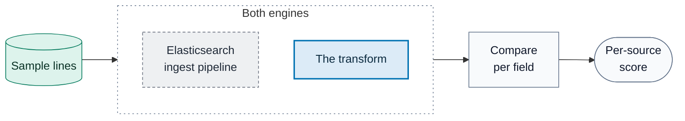

# compat -- measuring against the Elastic engine

compat runs a source's sample lines through that source's ingest pipeline in a throwaway Elasticsearch container and keeps the documents the engine returns. The corpus test scores each transform against them field by field. The corpus and its test are not part of this repository.

What a difference means, and which differences are kept on purpose, is [compat-policy.md](compat-policy.md).

Elasticsearch's output is the reference, and the score is per source.

*Figure 1. L4 Detail -- How a transform is scored. The dashed box is external.* Up: [L3 Components -- dfe-transform-elastic](architecture.md#four-steps-between-the-producers-and-the-sink).

The comparison reads `tests/compare-policy.yaml` through `dfe_runtime::testutil::policy`, so the rules live here beside the runtime.

## Known limits

- o365 and panw are incomplete. Part of their transformation runs inside Filebeat before Elasticsearch sees the event: o365 has a JavaScript processor chain, and panw applies `decode_csv_fields` to `message`. The simulate API reaches neither, so for those two the confirmed output covers the Elasticsearch half.
- GeoIP is not compared. The corpus test turns its GeoIP enricher off and excludes GeoIP-derived fields. An event can still have geo fields its source supplied.
- The engine never ships. Elasticsearch is a development dependency of the measurement, never part of the service.
