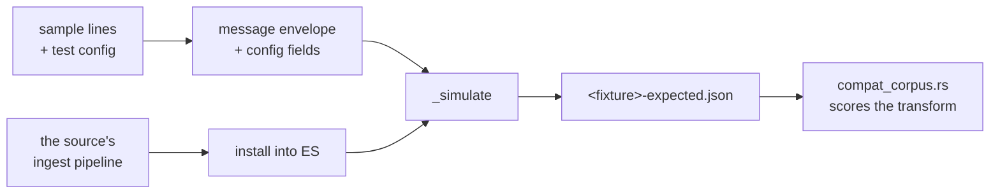

# compat -- confirmed output from the real Elastic engine

compat runs a fixture's sample lines through the source's own ingest pipeline in a throwaway Elasticsearch container and keeps the documents the engine returns. Those documents are ground truth: what the real engine produces, rather than what we believe it produces. The corpus test scores each transform against the confirmed fixtures it can load.

What a difference MEANS -- the ratchet, the compare policy, and the divergences kept on purpose -- is [compat-policy.md](compat-policy.md).

## What is committed

A confirmed sample under `tests/fixtures/<package>/<data stream>/` has `<sample>-expected.json` beside it. The samples under `tests/fixtures/unencumbered/` are inputs only.

| Key | Holds |
|---|---|
| `meta` | The package and data stream, the engine version, the pipeline commit, the entry pipeline, and the fields the test config marks as nondeterministic |
| `input` | The documents the engine was sent, exactly as the pipeline saw them |
| `expected` | The documents it returned, one per input, or `_compat_error` where the pipeline dropped or failed the event |

`crates/dfe-transforms/tests/compat_corpus.rs` reads these files, runs the same inputs through the transform, and compares field by field. It starts no container and needs no network.

The confirmed documents are produced by the meta project that maintains the transforms, which runs the engine. `tests/fixtures/PROVENANCE.md` names the tools.

## Known limits

- **o365 and panw are incomplete.** Part of their transformation runs inside Filebeat before Elasticsearch sees the event: o365 has a JavaScript processor chain, and panw applies `decode_csv_fields` to `message`. The simulate API cannot reach either, so for those two the confirmed output covers only the Elasticsearch half.
- **GeoIP is off.** The documents are confirmed with no GeoIP database loaded. The corpus test disables its GeoIP enricher and excludes GeoIP-derived fields from the comparison, and an event can still carry geo fields its source supplied.
- **The engine never ships.** The Elasticsearch image is a development dependency of the meta project only and must never become part of the shipped service.
