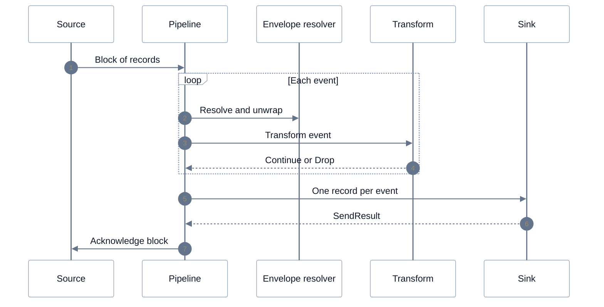

# Delivery

Delivery is how [dfe-transform-elastic](architecture.md) takes a block from its source, parses it, and gives each event its own record to the sink.

| | |
|---|---|
| Repo | [hyperi-io/dfe-transform-elastic](https://github.com/hyperi-io/dfe-transform-elastic), `src/pipeline.rs` and `src/service.rs` |
| Image and chart | `ghcr.io/hyperi-io/dfe-transform-elastic`, and the thin chart each release assembles from `src/deployment.rs` |
| Config reference | `source`, `sink`, `dlq` and `source.acknowledgements` in [config.example.yaml](../config.example.yaml) and [configuration.md](configuration.md) |
| Endpoints | Push listener on 6000 on the direct transport. Metrics and health on 9090 |
| Metrics | `events_transformed_total`, `events_errored_total`, `events_oversize_total`, `send_filtered_dlq_total`, `pipeline_dead_letters_dropped_total{reason}` on `:9090/metrics` |

With `source.acknowledgements` on, the default, the source is acknowledged after the sink takes the batch.

*Figure 1. L4 Detail -- One batch through the service. Continue or Drop and SendResult are responses.* Up: [L3 Components -- dfe-transform-elastic](architecture.md).

## How it works

The loop is scalo's `BatchEngine` (`service.rs::run_loop`). It holds each block's source acknowledgement, the Kafka offset commit on the bus or the answer to a push on direct, until the sink has taken every event built from it. `source.acknowledgements.enabled: false` releases it at receipt, and a crash then loses what was in flight.

JSON is the one payload format. A MessagePack record, which DFE/XDR 2.0 and 2.1 accepted, is a dead letter like any other binary.

An event that fails to unwrap or transform is counted on `events_errored_total` and left out of the output, and the batch continues. A transform that returns `Continue` has its `event.original` settled as [parity.md](parity.md) describes.

## Interfaces

Each event goes out as a separate record. `pipeline.rs::serialise_events_with_oversize` gives each one a payload, and `service.rs::send_blocks` sends them in blocks through `TransportSender::send_batch`, because dfe-loader parses one JSON document per message ([#67](https://github.com/hyperi-io/dfe-transform-elastic/issues/67)). `sink.max_message_bytes`, 8,000,000 bytes by default, bounds each payload under the 16 MiB producer ceiling and each block under gRPC's 16 MiB. An event over the budget goes to the DLQ, with its size and the budget as the reason, and is counted on `events_oversize_total`. No broker would take it, and retrying would block the partition.

The sink's answer decides what happens to the block:

| `SendResult` | Meaning | Response |
|---|---|---|
| `Ok` | The sink took it | Counted delivered |
| `Backpressured` | A full producer queue, or a broker or listener out of reach | Retried until the sink takes it |
| `Fatal` | A timeout is retried like `Backpressured`. Anything else, such as authorisation, a missing topic or a closed transport, is not | Stop, block unreleased |
| `FilteredDlq` | The sink transport sent a block's records and dead-lettered at least one, without naming it | Its records are sent one at a time, each counted delivered or, for the one answered `FilteredDlq`, filtered on `send_filtered_dlq_total` and `records_filtered_total` and written to the DLQ, then the block is released |

## Scaling and failure

When the sink answers `Backpressured`, the block is held and retried until the sink takes it, and nothing after it is committed. A failure no retry can fix stops the loop with the block unreleased, so the restarted consumer reads it again. The direct listener holds pushes from the moment it binds, so a push that lands before the loop starts waits for delivery rather than being answered on arrival.

A push is held at most the hold of this stage's rung on scalo's hold ladder (`push_max_hold`), inside the deadline the stage in front waits, and the bytes held are leased on the memory guard. Every send a held block waits on gives up at that rung's next-hop deadline (`next_hop_send_timeout_ms`): a direct sink's gRPC deadline, and on the bus the producer's `message.timeout.ms` when a direct source holds its pushes. A send that outlasted the hold would land after the push was answered `unavailable`, and its retry would be a duplicate.

Duplicates are the accepted cost: a retried block re-sends the records that landed, so every consumer downstream must be idempotent.

A record the sink transport would reject, over its `message.max.bytes` or matched by an outbound `dlq` filter, is screened out before the send. Input that is not JSON is a dead letter with the reason `payload is not JSON`: the whole record when no line parses, else the bad line. Both go to the DLQ `dlq` configures, a file DLQ by default, and the block is released once the DLQ holds them. With `dlq.enabled: false` they are dropped and counted on `pipeline_dead_letters_dropped_total{reason}` and `dlq_dropped_total`.

## Key metrics

| Metric | Healthy when |
|---|---|
| `events_transformed_total` | Tracks the events in |
| `events_errored_total` | Flat. A rise is events no handler kept |
| `events_oversize_total` | Flat. Each is an event too big for one record |
| `pipeline_dead_letters_dropped_total{reason}` | Zero while a DLQ is on |

## Related

- [Transform](transform.md), what runs on each event
- [Unwrap envelope](envelopes.md), what each event is unwrapped from
- [configuration.md](configuration.md), `sink.max_message_bytes` and `source.acknowledgements`
