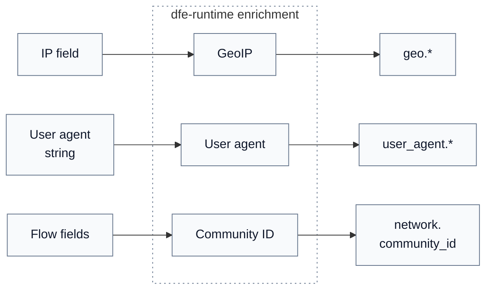

# Enrichment

GeoIP, user agent and community ID are the three runtime enrichers in `crates/dfe-runtime/src/enrichment/`, loaded once and shared across every transform. A generated transform calls one where its pipeline has a `geoip`, `user_agent` or `community_id` processor ([parsers.md](parsers.md#processor-taxonomy)). The code map is [architecture.md](architecture.md).

Each enricher reads one kind of field and writes one subtree back onto the same event.

*Figure 1. L4 Detail -- Enrichers.* Up: [L3 Components -- dfe-transform-elastic](architecture.md#four-steps-between-the-producers-and-the-sink).

GeoIP provisioning, storage, cache, output and failure:

- Provisioning: the config's `geoip` section is scalo's `GeoIpConfig` as-is, because provisioning is shared across the fleet, and the lookup and its cache stay in `dfe-runtime`. It defaults to enabled, with auto-download from DB-IP Lite, and is read once at startup.
- Storage: the MMDB is memory-mapped through the `maxminddb` crate.
- Cache: a bounded cache in front of the reader (`geoip_cache.rs`), 100,000 entries by default. When full it evicts the oldest-stored quarter rather than tracking use, so a hit takes the read lock and updates nothing. A transform with several `geoip` processors hits the cache several times an event, counted on `geoip_cache_hits_total` and `geoip_cache_misses_total`.
- Output fields: `continent_name`, `country_name`, `country_iso_code`, `region_name`, `region_iso_code`, `city_name`, `location` (`lat`, `lon`) and `timezone`, plus `asn`, `organization_name` and `network` from an ASN database.
- Failure: none reaches the event. A generated `geoip` call skips an absent field, and a value that is not an IP, a private address or a lookup miss writes no fields (`geoip_global.rs`).

The user agent parser matches pre-compiled regexes against the string and writes `original`, `name`, `version`, `os.name`, `os.version`, `os.full`, `device.name` and, where it can tell, `device.type`. Its output differs from Elastic's ua-parser in small ways.

Community ID is v1, a SHA-1 hash of the flow, read from `source.ip`, `destination.ip`, `source.port`, `destination.port` and `network.transport` or `network.iana_number`, with `icmp.type` and `icmp.code` for ICMP. It writes `network.community_id`, such as `1:LQU9qZlK+B5F3KDmev6m5PMibrg=`.
