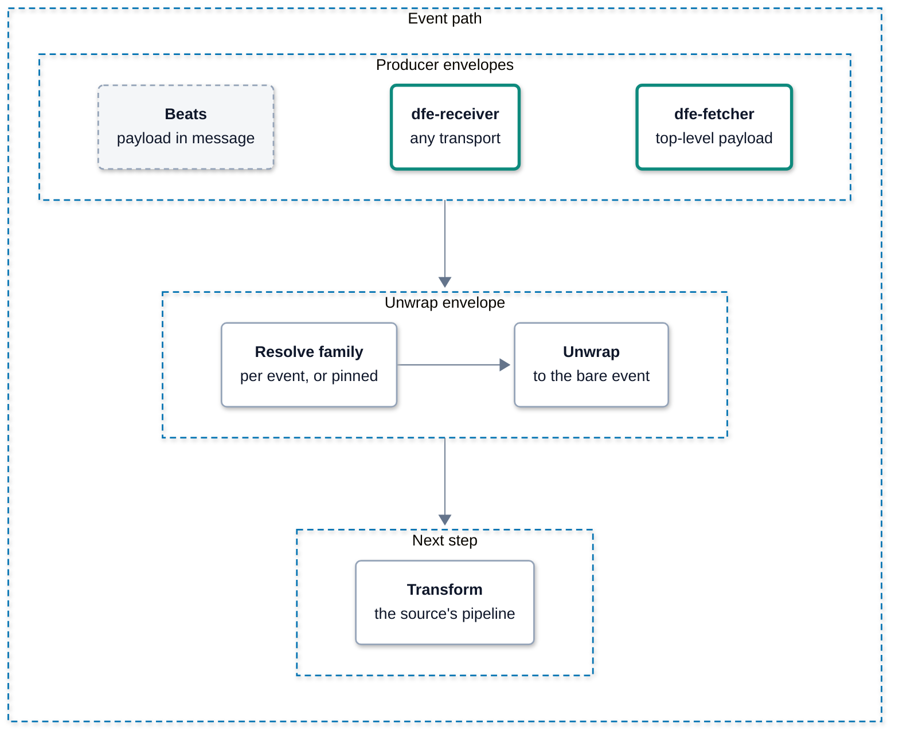

# Unwrap envelope

Unwrap envelope is the step in [dfe-transform-elastic](architecture.md) that reads which producer wrapped each event and hands the transform the bare event it was written for.

| | |
|---|---|
| Repo | [hyperi-io/dfe-transform-elastic](https://github.com/hyperi-io/dfe-transform-elastic), `src/envelope.rs` and `src/registry.rs` |
| Image and chart | `ghcr.io/hyperi-io/dfe-transform-elastic`, and the thin chart each release assembles from `src/deployment.rs` |
| Config reference | `source.envelope` in [config.example.yaml](../config.example.yaml) |
| Endpoints | None of its own |
| Metrics | `envelope_unaccepted_total`, `envelope_contradicted_total` on `:9090/metrics` |

`source.envelope` is `auto` (the default), `beats`, `receiver` or `fetcher`.

*Figure 1. L4 Detail -- Unwrap envelope. Beats is outside DFE.* Up: [L3 Components -- dfe-transform-elastic](architecture.md).

## How it works

`auto` resolves the family per event. A scalo `WorkBatch` spans partitions, so one batch can hold two producers' wrappers. The cost is a few top-level key checks, against an unwrap that cost 2,740 ns an event when benchmarked.

A bare payload with no producer marker is the one quiet failure. Detection falls back to `beats`, there is no `message` to unpack, and the transform runs and emits with almost nothing renamed. Output that looks like the input with an `ecs.version` added is this.

## Interfaces

- `beats` -- the raw payload as a string in `message`. The transforms are written for this, and Elastic Agent and anything passing a Beats document through unaltered produce it.
- `receiver` -- [dfe-receiver](https://github.com/hyperi-io/dfe-receiver)'s JSON on any of its transports. The syslog arm rebuilds a line into `message`, and the rest pass their payload through with the receiver's field names moved onto the ECS paths they would shadow.
- `fetcher` -- [dfe-fetcher](https://github.com/hyperi-io/dfe-fetcher)'s JSON, the provider's payload at the top level, for sources where Elastic's agent input is a pure transport.

`registry.rs` records a syslog framing for every source the receiver can deliver:

- `Body` sources, such as `panw` and `cisco_meraki`, read `message` as CSV or key-value, so the body goes through with no header. A tagless PAN-OS line arrives with its first CSV field in `appname`, and when that is not a valid tag the body is rebuilt from `appname`, `procid` and `message`.
- `Line` sources, such as `fortinet`, `cisco_ios` and `cisco_nexus`, grok the header out of `message`. The line is the receiver's opt-in `_raw` where present, else an RFC 3164 line rebuilt from the parsed fields. That is enough for `fortinet`, which wants `<PRI>`, and not for `cisco_ios` or `cisco_nexus`, which want a source IP and a sequence number the receiver does not keep.

## Scaling and failure

A pinned envelope a source cannot arrive in is rejected at startup against the source's `Intake`. okta is pulled from an API, so it accepts `beats` and `fetcher` and rejects `receiver`. `auto` has no event to check at startup, so the same mismatch is counted per batch on `envelope_unaccepted_total`.

## Key metrics

| Metric | Healthy when |
|---|---|
| `envelope_unaccepted_total` | Zero. A count is an envelope the source can't arrive in |
| `envelope_contradicted_total` | Zero. A count is a batch that did not look like the pinned envelope |

## Related

- [Transform](transform.md), which runs on the bare event
- [configuration.md](configuration.md), agentless mode and the transports
