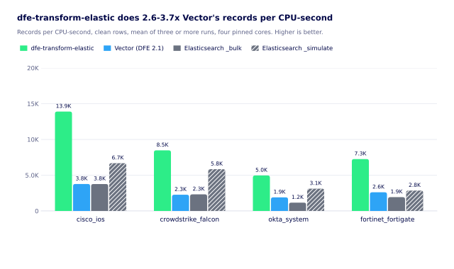
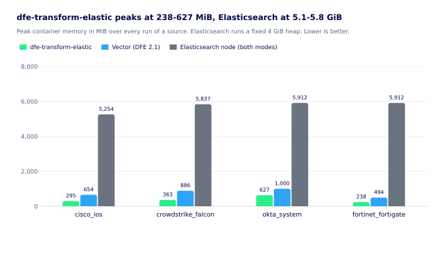
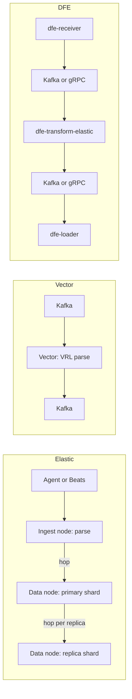
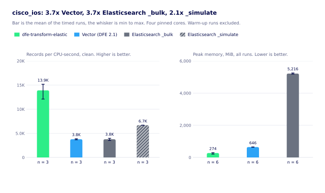
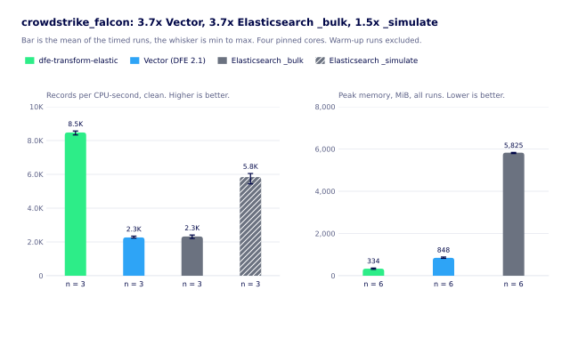
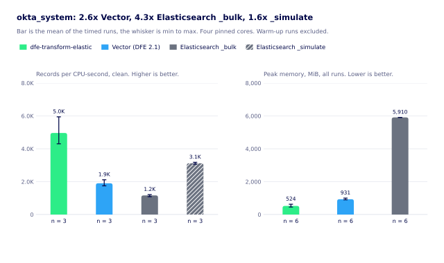
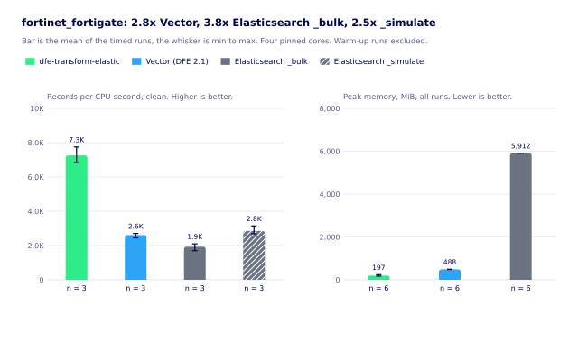

# What Elasticsearch ingest costs

Elastic-equivalent ingest for up to 5x less CPU and 19x less memory, on the exact same sources, with zero wrong fields.

What does it cost to turn raw vendor lines into ECS ('the field names Elastic's dashboards and rules expect')? We ran four sources through three engines to find out: dfe-transform-elastic, the DFE 2.1 Vector pipeline, and Elasticsearch running Elastic's own ingest pipelines.

Up to 16x less. That's the path from Elastic's own ingest to DFE 2.2, in two steps:

- **Up to 4x** moving parsing off Elasticsearch and OpenSearch ingest onto an autoscaled DFE 2.1 pipeline. Proven in production.
- **Up to 4x again** moving that pipeline to purpose-built Rust in DFE 2.2. Proven in production, and up to 4.2x in this bench.

Against Elastic's own ingest, for the parse alone:

- Up to 19x less memory for the same throughput, and never less than 4.7x. That holds wherever the parsed data goes next: ClickHouse, or back into Elasticsearch or OpenSearch.
- Up to 5.8x less CPU over a working year, once the ingest tier is sized for the peak.
- Zero wrong fields against Elastic's own output, on every source tested.

Same four sources, same rows, same four pinned cores on one host, all on 2026-11-10. The bench scripts and every run are in [scripts/bench](../scripts/bench), and [benchmark.md](benchmark.md) has the method.

This page keeps three kinds of claim apart: what we MEASURED, what we DERIVED from those numbers, and what we only ESTIMATE.

## What did we compare?

Three engines, the same raw lines in, ECS documents out.

- dfe-transform-elastic v1.1.28 (the DFE 2.2.2 pin, `sha256:fe855751df2c`), Kafka in and Kafka out.
- The DFE 2.1 Vector VRL templates on Vector 0.48.0, Kafka in and Kafka out.
- Elasticsearch 9.5.6 running Elastic's own integration pipelines. Once through `_simulate` ('run the pipeline, index nothing') and once through `_bulk` ('run the pipeline, then index').

Four sources, one per parser family: `cisco_ios`, `crowdstrike_falcon`, `okta_system` and `fortinet_fortigate`. Each ran clean and with 20% of rows corrupted.

Why both Elasticsearch modes? `_simulate` is the parse alone, the share an ingest node pays. `_bulk` adds indexing, which in this bench ran on the same node.

The bench ran the parse boxes and nothing around them. The hops are the reason the cluster estimate further down exists.

## What did the bench measure?

MEASURED. Records per CPU-second, clean rows, mean of three runs:

| engine | cisco_ios | crowdstrike_falcon | okta_system | fortinet_fortigate | peak memory | cores used of 4 |
|---|---|---|---|---|---|---|
| dfe-transform-elastic | 13,900 | 8,475 | 4,962 | 7,257 | 238-627 MiB | 0.99-1.05 |
| Vector VRL | 3,771 | 2,268 | 1,902 | 2,611 | 494-1,000 MiB | 3.86-3.96 |
| Elasticsearch `_simulate` | 6,682 | 5,839 | 3,119 | 2,850 | 5.1-5.8 GiB | 3.00-3.48 |
| Elasticsearch `_bulk` | 3,765 | 2,322 | 1,164 | 1,931 | 5.1-5.8 GiB | 3.61-3.78 |

Each bar below is a mean with its min-max range as a whisker. The table under it gives n, mean, min, max and standard deviation. The last column is dfe-transform-elastic's mean divided by that engine's mean.

| engine | n | mean | min | max | sd | dfe-transform-elastic mean over it |
|---|---|---|---|---|---|---|
| dfe-transform-elastic | 3 | 13,900 | 12,099 | 15,169 | 1,603 | - |
| Vector VRL | 3 | 3,771 | 3,662 | 3,875 | 107 | 3.69x |
| Elasticsearch `_bulk` | 3 | 3,765 | 3,519 | 3,962 | 226 | 3.69x |
| Elasticsearch `_simulate` | 3 | 6,682 | 6,675 | 6,690 | 8 | 2.08x |

| engine | n | mean | min | max | sd | dfe-transform-elastic mean over it |
|---|---|---|---|---|---|---|
| dfe-transform-elastic | 3 | 8,475 | 8,332 | 8,563 | 125 | - |
| Vector VRL | 3 | 2,268 | 2,230 | 2,342 | 64 | 3.74x |
| Elasticsearch `_bulk` | 3 | 2,322 | 2,203 | 2,410 | 107 | 3.65x |
| Elasticsearch `_simulate` | 3 | 5,839 | 5,438 | 6,049 | 347 | 1.45x |

| engine | n | mean | min | max | sd | dfe-transform-elastic mean over it |
|---|---|---|---|---|---|---|
| dfe-transform-elastic | 3 | 4,962 | 4,305 | 5,944 | 867 | - |
| Vector VRL | 3 | 1,902 | 1,748 | 2,114 | 190 | 2.61x |
| Elasticsearch `_bulk` | 3 | 1,164 | 1,086 | 1,213 | 69 | 4.26x |
| Elasticsearch `_simulate` | 3 | 3,119 | 3,070 | 3,178 | 55 | 1.59x |

| engine | n | mean | min | max | sd | dfe-transform-elastic mean over it |
|---|---|---|---|---|---|---|
| dfe-transform-elastic | 3 | 7,257 | 6,844 | 7,748 | 457 | - |
| Vector VRL | 3 | 2,611 | 2,448 | 2,705 | 142 | 2.78x |
| Elasticsearch `_bulk` | 3 | 1,931 | 1,699 | 2,098 | 208 | 3.76x |
| Elasticsearch `_simulate` | 3 | 2,850 | 2,686 | 3,143 | 255 | 2.55x |

The statistics are per run. The rig keeps no per-interval samples, so there's no p50, p95 or p99 here, and three runs wouldn't give a real one.

How the runs were judged: a warm-up run first, left out of every figure. Then three timed runs per cell. Each run waited for the 1-minute load to drop under 2.0 (`--max-load`). One run was logged above it and repeated. Every engine sat on the same four pinned cores.

The limits, stated plainly:

- The 1-minute load was 1.4-2.0 at every start. Other work still used 2-21% of the cores outside the bench's own (median 5%).
- Quiet didn't mean tight. Across the 32 cells, the gap between a cell's best and worst run had a median of 11% and a worst case of 38% (dfe-transform-elastic on `okta_system`). Read a ratio as good to about 20%.
- Elasticsearch ran as one node with every role. Its memory figure is a fixed 4 GiB heap plus the JVM, read as the container's peak since it started. So it tracks the heap and the run order, not the load.
- dfe-transform-elastic ran under an 8 GiB container limit, not its 512Mi pod limit. `okta_system` peaked at 627 MiB.
- Output was checked for dfe-transform-elastic only: zero wrong fields against Elasticsearch on all four sources. Vector's output wasn't compared.

## How much does it save?

DERIVED. Worked out from the table above. Nothing new was run.

- Against the 2.1 Vector pipeline, dfe-transform-elastic uses 2.6-3.7x less CPU per record.
- Against an Elasticsearch ingest node (`_simulate`), it uses 1.5-2.5x less. Against parse plus index (`_bulk`), 3.7-4.3x less.
- Those are the clean rows. With 20% of rows corrupted, the top ends reach 4.2x and 5.2x (per source in [benchmark.md](benchmark.md)).
- Memory for the same throughput, as peak MiB per record a second:
  - dfe-transform-elastic needs 4.7-19.0x less than an Elasticsearch ingest node, and 1.1-2.5x less than Vector.
  - Vector needs 3.3-12.4x less than the Elasticsearch node.
  - Elasticsearch's figure is its fixed heap, so read it as the memory you provision, not what the parse uses.
- Vector is slower than Elasticsearch's own pipeline at the parse alone: 0.39-0.92x of `_simulate`. So the first step's gain is memory and sizing for the peak, not CPU per record. The production section shows it held anyway.
- dfe-transform-elastic uses about one core per instance and scales out with pods. Per pinned core, one instance trails Vector on three of the four sources, `okta_system` by the most (1,246 vs 1,839 rec/s).

## Why compile the pipelines?

Elasticsearch runs an ingest pipeline on the JVM, processor by processor, with Painless scripts for the awkward bits.

dfe-transform-elastic turns each source's pipeline into Rust at build time, one module per source, with no interpreter in the path. It reads the same Elastic pipelines, so the output is Elastic's.

That's the design.

We haven't profiled where the time goes in each engine. So we can't say how much of the gap is the JVM, the heap or the grok engine. The table says how big the gap is. It doesn't say why.

## Did it hold in production?

PROVEN. The bench says Elasticsearch's own pipeline beats Vector at the parse alone. Production said the opposite, and by a lot.

On DFE 2.1, parsing Filebeat and Winlogbeat data in Vector cost less than Elastic's Painless pipelines for existing Elasticsearch and OpenSearch clusters. Two live deployments proved it, a large telco and a large-scale government agency.

Each ran OpenSearch at 10-100 TB a day as the analyst discovery service, a sidecar to the ClickHouse instance doing the heavy lifting. (The DFE console replaces that sidecar in 2.2.) Running both side by side gave us a bake-off of the two approaches as a bonus.

The PB-scale tests proved it again. We ran two tests on DFE 2.1 to prove its schema models and ingest scale, the design that became DFE 2.2. That design moved the hot path out of Vector into purpose-built Rust, which is dfe-transform-elastic.

The bench is one node at a steady rate. A real cluster pays for the tier the parse runs on, sized for the peak.

## Why not just scale Elastic's ingest nodes?

You can. They just can't follow the load.

dfe-transform-elastic scales with the data. KEDA ('the autoscaler that watches the backlog') adds pods when input queues up and removes them when it drains.

Dedicated ingest nodes can't do that.

On Elastic Cloud on Kubernetes, Elastic Cloud Hosted and Elastic Cloud Enterprise, autoscaling covers data tiers and machine learning nodes only. A node with just the ingest role isn't autoscaled.

On Hosted, data tiers only scale up, and not on CPU or memory. So ingest nodes get sized for the peak and sit there at the lows. Elastic Cloud Serverless is the exception: it scales to usage.

Sources: https://www.elastic.co/docs/deploy-manage/autoscaling and https://github.com/elastic/cloud-on-k8s/issues/6236

ESTIMATE. **From a stated load profile, not a measurement.** What does a working year do to the sums?

Security and ops data follows the working day. Take a typical Australian organisation, with the share of peak load as:

- Midnight to 6am: 25%.
- From 6am, hour by hour: 40, 70, 100, 100 (morning logins), 85, 80, 70 (lunch), 100, 100 (back from lunch), 85, 70, 55, 40 and 30.
- From 8pm: 25%.
- Weekends and 11 weekday public holidays (8 national, about 3 state): 25% all day.

Over a year that averages 44% of peak, and only 11% of hours run at 100%.

Fixed ingest nodes are sized for the peak, so they carry 1 / 0.44 = 2.26x the capacity the load needs on average. The transform scales to the load, so it doesn't. Give both the same headroom and it cancels out.

That multiplies the per-record saving:

| | per record (MEASURED) | over the year (ESTIMATE) |
|---|---|---|
| dfe-transform-elastic vs an Elasticsearch ingest node | 1.5-2.5x less CPU | about 3.3-5.8x less provisioned CPU |
| dfe-transform-elastic vs the 2.1 pipeline | 2.6-3.7x less CPU | the same 2.6-3.7x (2.1 autoscaled too) |

Your own profile changes the 2.26x. Divide peak by mean load and multiply.

## What would a real cluster add?

ESTIMATE. **Not a measurement.** None of it is in the numbers above. It's counted from the documented write path, and a multi-node run is the only way to size it.

- Ingest nodes are cluster members. Each holds cluster state, takes part in fault detection and runs its own JVM heap and GC, busy or not. For heavy ingest, Elastic recommends dedicated ingest nodes.
- Every parsed document crosses the cluster again, to its primary shard's node.
- Every replica gets the document over the network and indexes it again. With `n` replicas that's `1 + n` hops and `1 + n` indexes per record.
- A Logstash shipper is one more JVM fleet in front.

OpenSearch does the same by default, so treat the two as one.

Two newer models change the replica cost. OpenSearch segment replication (2.7 on, set when the index is created) indexes once and copies finished segments. Elastic Cloud Serverless writes segments to object storage, and search nodes read them from there. Self-managed Elasticsearch keeps the model above.

DFE has hops too: receiver, Kafka or gRPC, transform, loader, ClickHouse and its replicas. But the transform's Kafka read and write are inside its measured CPU, and no DFE stage holds a cluster seat just to parse.

The replication models above come from:

- https://www.elastic.co/search-labs/blog/elasticsearch-serverless-stateless-architecture
- https://www.elastic.co/search-labs/blog/thin-indexing-shards-elasticsearch-serverless
- https://docs.opensearch.org/latest/tuning-your-cluster/availability-and-recovery/segment-replication/index/
- https://opensearch.org/blog/remote-backed-storage/

No ingest tier. That's the saving.

## What did we leave out?

- Everything after the parse. The 2.1 timestamp, enrichment and ClickHouse remap templates aren't in the Vector chain, and only the source under test is wired to its route.
- A multi-pod run, a disk buffer, TLS, and Elasticsearch with replicas or several shards.
- Where the time goes inside each engine.
- Whether Vector's output matches Elastic's. We never compared it field by field.
