# Parsers and processors

Grok runs on compiled regex at almost every call site. Three whole-pattern forms take a native path instead, and the composite builder and DFA fallback in `dfe-parse` are built but not called by any transform. This page covers that dispatch, every ingest processor the transforms use, and how far the Painless matchers reach. The code map is [architecture.md](architecture.md), and the libraries are [performance.md](performance.md).

`grok_cache::native_form` recognises whole-pattern forms and rejects a near-miss rather than guessing at one: a pattern with literal text around its captures stays on the regex.

A grok call site in a native form skips the regex, and every other site runs its compiled regex.

```mermaid
---
config:
  theme: base
  look: neo
  fontFamily: Inter, -apple-system, Segoe UI, Roboto, Helvetica, Arial, sans-serif
  flowchart:
    curve: linear
    nodeSpacing: 40
    rankSpacing: 64
    padding: 18
    wrappingWidth: 280
    htmlLabels: true
  elk:
    preset: modelOrder
  themeVariables:
    fontSize: 15px
    lineColor: "#64748B"
    primaryTextColor: "#0F172A"
    clusterBorder: "#0072B2"
    edgeLabelBackground: "#FFFFFF"
  themeCSS: >-
    p{margin:0}
    .node[data-look] rect,.node[data-look] path,.node[data-look] polygon,.node[data-look] .outer-path{filter:drop-shadow(0 1px 2px rgba(15,23,42,.10)) drop-shadow(0 6px 14px rgba(15,23,42,.10))}
    .node rect{rx:10px;ry:10px}
    .cluster rect{rx:16px;ry:16px}
    .node .label div{min-width:150px}
    .node.decision .label div{min-width:0}
    .cluster[data-look] rect{filter:none}
    .nodeLabel{line-height:1.35}
    .nodeLabel b{font-weight:600;font-size:15px;letter-spacing:-0.01em}
    .nodeLabel span{font-size:12.5px;font-weight:400;color:#334155}
    .cluster-label span.nodeLabel{display:inline-block;background:#FFFFFF;color:#0B2A3F;border:1.5px solid #0072B2;border-radius:999px;padding:2px 12px;font-size:11.5px;font-weight:700;letter-spacing:.09em;text-transform:uppercase}
    .flowchart-link{stroke-width:1.75px}
    .labelBkg{background:transparent!important}
    span.edgeLabel{display:inline-block;background:#FFFFFF!important;color:#1E293B;border:1px solid #94A3B8;border-radius:999px;padding:2px 10px;font-size:12px;font-weight:500}
    span.edgeLabel p{background:transparent!important}
    .label-icon{width:20px;height:20px;vertical-align:-4px;margin-right:6px}
    .ingest .label-icon{color:#0E8A7D}
    .xform .label-icon{color:#7B4FB0}
    .load .label-icon{color:#0072B2}
    .bus .label-icon{color:#A8517F}
    .store .label-icon{color:#00785A}
    .ui .label-icon{color:#D9480F}
    .ext .label-icon{color:#64748B}
---
flowchart LR
    accTitle: L4 Detail -- Grok dispatch
    accDescr: A grok call site checks whether its pattern is one of the native whole-pattern forms. If so it runs a dfe-parse parser or a newline scan, otherwise the compiled regex. Both return the captured fields.

    site(["<b>Grok call site</b>"])
    form{"<b>Native<br/>form?</b>"}
    native["<b>dfe-parse or<br/>newline scan</b>"]
    regex["<b>Compiled regex</b>"]
    fields(["<b>Captured fields</b>"])

    site --> form
    form -->|yes| native
    form -->|no| regex
    native --> fields
    regex --> fields
  classDef ext fill:#F4F6F8,stroke:#94A3B8,stroke-width:1.5px,stroke-dasharray:5 4,color:#0F172A
  classDef ingest fill:#FFFFFF,stroke:#0E8A7D,stroke-width:3px,color:#0F172A
  classDef xform fill:#FFFFFF,stroke:#7B4FB0,stroke-width:3px,color:#0F172A
  classDef load fill:#FFFFFF,stroke:#0072B2,stroke-width:3px,color:#0F172A
  classDef bus fill:#FFFFFF,stroke:#A8517F,stroke-width:3px,color:#0F172A
  classDef store fill:#FFFFFF,stroke:#00785A,stroke-width:3px,color:#0F172A
  classDef ui fill:#FFFFFF,stroke:#D9480F,stroke-width:3px,color:#0F172A
  classDef decision fill:#FFFFFF,stroke:#9A6700,stroke-width:3px,color:#0F172A
  classDef error fill:#FFFFFF,stroke:#C2410C,stroke-width:3px,color:#0F172A
  classDef control fill:#FFFFFF,stroke:#334155,stroke-width:3px,color:#0F172A
  classDef part fill:#FFFFFF,stroke:#94A3B8,stroke-width:1.5px,color:#0F172A
  class form decision
  class site,native,regex,fields part
```



*Figure 1. L4 Detail -- Grok dispatch.* Up: [L3 Components -- dfe-transform-elastic](architecture.md#four-steps-between-the-producers-and-the-sink).

| Pattern | Path | Native against regex |
|---|---|---|
| `^%{IPV4:f}$` | `dfe_parse::ip::parse_ipv4` | 29 ns against 214 ns |
| `^%{IPV4:a}:%{PORT:p}$` | the two chained | 47 ns against 208 ns |
| `%{GREEDYDATA:f}`, anchored or not | `split_once('\n')` | 11 ns against 1,098 ns |

The timings come from `cargo bench -p dfe-runtime --bench grok`. The third form reaches no parser: `line_anchored` makes it `(?m)^.*$` because joni anchors to lines, so it captures the first line and the native form is a newline scan. Count the sites from the generated tree (`cached_grok!` and `cached_grok_mapped!`) rather than from a figure written here.

`^%{DATA:f}$` is excluded although it reads the same: `%{DATA}` is the lazy `.*?`, and on a `\r\n` line ending greedy keeps the `\r` in the capture where lazy stops before it. Every dispatched form has an equivalence test running both paths over the same inputs, because the native path is an optimisation over the regex and never a replacement for it.

`dfe-parse` holds more than the dispatch uses. Layer 1 is native parsers for 15 common grok patterns, in `ip.rs`, `network.rs`, `numeric.rs`, `string.rs` and `timestamp.rs`:

| Grok pattern | Rust parser | Technique |
|---|---|---|
| `%{IPV4}` | `parse_ipv4()` | Octet validation, direct byte scan |
| `%{IPV6}` | `parse_ipv6()` | Colon-group parser |
| `%{IPORHOST}` | `parse_ip_or_host()` | Try IP first, fall back to hostname |
| `%{INT}` | `parse_int::<T>()` | Direct digit scan, generic over type |
| `%{NUMBER}` | `parse_number()` | Integer or float with optional exponent |
| `%{WORD}` | `take_word()` | Byte-level alphanumeric scan |
| `%{GREEDYDATA}` | `take_greedy()` | Returns the remaining slice |
| `%{TIMESTAMP_ISO8601}` | `parse_iso8601()` | Fixed-position field extraction |
| `%{SYSLOGTIMESTAMP}` | `parse_syslog_timestamp()` | Month lookup table and digit parse |
| `%{LOGLEVEL}` | `parse_loglevel()` | Case-insensitive keyword match |
| `%{QUOTEDSTRING}` | `take_quoted()` | memchr for the quote, handles escapes |
| `%{HOSTNAME}` | `parse_hostname()` | Label-dot-label (RFC 1123) |
| `%{MAC}` | `parse_mac()` | Fixed 6-group hex parse |
| `%{URI}` | `parse_uri()` | scheme://authority/path?query#fragment |
| `%{UUID}` | `parse_uuid()` | Fixed 8-4-4-4-12 hex pattern |

Every parser takes `&str` and returns `ParseResult<'_, T>`, the remaining input and the parsed value, following the winnow and nom convention:

```rust
pub type ParseResult<'a, T> = Result<(&'a str, T), ParseError>;
```

Layer 2, `composite.rs`, chains Layer 1 parsers with literal separators. Layer 3, `dfa.rs`, wraps `regex_automata::meta::Regex` and returns named captures. Both are built and tested in `dfe-parse`, and no transform calls either.

```rust
// Grok: %{IPORHOST:source_ip}:%{INT:source_port} -> %{IPORHOST:dest_ip}:%{INT:dest_port}
let parser = CompositeParser::builder()
    .capture("source_ip", parse_ip_or_host)
    .literal(":")
    .capture("source_port", parse_int::<u16>)
    .literal(" -> ")
    .capture("dest_ip", parse_ip_or_host)
    .literal(":")
    .capture("dest_port", parse_int::<u16>)
    .build();
```

## Processor taxonomy

Every processor the transforms use, and the code the generator emits for it.

| Processor | Weight | Code pattern |
|---|---|---|
| `set`, `append`, `remove`, `rename` | Simple | `event.set`, `event.append`, `event.remove`, `event.rename` |
| `uppercase`, `lowercase`, `trim` | Simple | Read the string, write it back changed |
| `convert` | Simple | `convert_value` to string, integer, long, float, double, boolean or ip |
| `drop` | Simple | Returns `TransformResult::Drop` |
| `split` | Simple | Splits a string into an array |
| `join` | Simple | `join_values(value, sep)`, `None` on a non-array |
| `uri_parts` | Simple | Scheme, host, port, path and query components |
| `dot_expander` | Simple | `dot_expand(event, path, field)` |
| `fail` | Simple | Returns a `TransformError` with the message |
| `terminate` | Simple | Stops the pipeline and keeps the document |
| `urldecode` | Simple | `url_decode`, form-encoded so `+` is a space |
| `sort` | Simple | `sort_values`, an error on anything with no natural order |
| `html_strip` | Simple | `html_strip` |
| `grok` | Medium | `cached_grok!`, one compiled pattern per call site, on `regex` or `fancy-regex` |
| `dissect` | Medium | Tokenizer-based split |
| `json` | Medium | `codegen_api::parse_json_str`, on `serde_json` |
| `kv` | Medium | Key-value split with configurable delimiters |
| `csv` | Medium | The `csv` crate, with the processor's separator and quote |
| `foreach` | Medium | Each element bound to `_ingest._value`, the inner processor run, the list rebuilt |
| `date` | Medium | `parse_date_out` against the formats the processor names |
| `gsub` | Medium | A cached regex `replace_all` |
| `script` (Painless) | Complex | A matched runner, or counted and skipped. See below |
| `geoip` | Complex | `enrichment::geoip` |
| `user_agent` | Complex | `enrichment::user_agent` |
| `community_id` | Complex | `enrichment::community_id` |
| `registered_domain` | Complex | `codegen_api::registered_domain_lookup`, a `psl` lookup against Mozilla's Public Suffix List |
| `network_direction` | Complex | CIDR-based internal and external classification |
| `fingerprint` | Complex | `fingerprint_default` (SHA-1, base64, NUL before each value), or `fingerprint_with` for a `salt` and SHA-256, SHA-512 or MurmurHash3. Any other method fails |
| `pipeline` (nested) | Complex | Inlined into the caller, not a call. `rg -l "Begin nested pipeline"` lists the modules |

Not implemented, and used by no shipped pipeline: `bytes`, `cef`, `date_index_name`, `enrich`, `geo_grid`, `inference`, `redact`, `reroute` and `set_security_user`.

## Painless coverage

A script the runtime cannot execute is skipped rather than failing the event, so the skips are counted, or they would look like a script that did nothing. `painless_exec` lives in `crates/dfe-painless/src/plan.rs` and is re-exported through `crates/dfe-runtime/src/codegen_api.rs`. It resolves a hand-written runner from `crates/dfe-painless/src/bespoke/` first, then the params patterns in `params.rs`, then the `known_patterns` ladder in `common.rs`, and records the outcome through `crates/dfe-painless/src/stats.rs`. The service exports the outcome as `painless_handled_total` and `painless_unhandled_total`.

A generated call site holds no script. The generator resolves the dispatch and emits `compiled_painless!` with the script's hash and that plan as JSON, plus the normalised text where a bound runner still reads it. The runtime looks bespoke runners up by the hash, and the counters key each script by it.

`crates/dfe-transforms/tests/painless_binding.rs` reads every plan out of the generated tree and asks what it binds to, which says a script is claimed but not that the runner writes anything. The two counters say what ran on live traffic. A pattern can match a script statically and decline at run time, which reads as covered everywhere except those counters.
