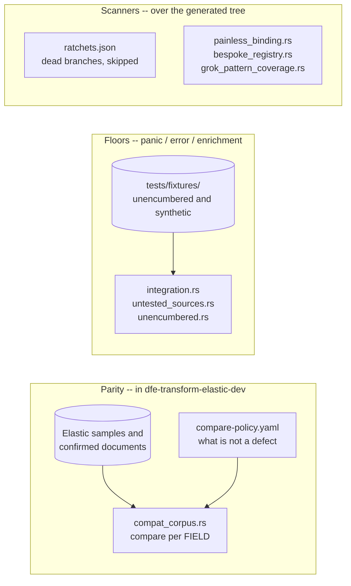

# Testing

The test tracks -- the parity corpus, the fixture floors, the scanners over the generated tree -- and the match modes and non-English sweeps they run under. The code map around them is [architecture.md](architecture.md), what parity means is [parity.md](parity.md), and how the corpus is produced is [compat.md](compat.md).

Three tracks, and only the first measures parity. It runs in the private dfe-transform-elastic-dev repository, because its corpus is Elastic's integration samples and the documents Elastic's engine produced for them, which this repository does not carry.



`tests/compare-policy.yaml` stays here because `dfe_runtime::testutil::policy` reads it, and dfe-transform-elastic-dev builds against this repository's runtime.

---

## The fixtures

`tests/fixtures/` holds two sets, and `tests/fixtures/PROVENANCE.md` says where each comes from:

- `unencumbered/` -- log samples from CC0, MIT and Apache-2.0 projects, under their own licences.
- `synthetic/` -- samples written for this repository, one file per log variant, each following the layout the product's maker publishes, with invented values.

Neither has expected output, so the floors over them assert what holds regardless of it: no panic, no new errors, and every event gains a field. An event the pipeline's failure handler marks with `error.message` counts as an error. The Beats envelopes under `tests/envelopes/beats/` are written the same way as the synthetic set.

The fixture tests read this committed data with no variable to set, so they run whenever CI does:

```bash
cargo test -p dfe-transforms --test integration --test untested_sources \
  --test grok_capture_paths --test unencumbered
cargo test -p dfe-runtime --all-features --lib --test date_repro
cargo test --no-default-features --test envelope --test envelope_detection
```

`crates/dfe-transforms/tests/unencumbered.rs` fails when `tests/fixtures/` holds anything but `unencumbered/`, `synthetic/` and the provenance, or when any file there carries one of three marker strings: the paths of Elastic's two source repositories, or its licence's name.

---

## Match modes

`crates/dfe-runtime/src/testutil/diff.rs` defines `MatchMode`:

| Mode | Use Case | Behaviour |
|---|---|---|
| **Exact** | Default | Field-for-field JSON match |
| **Semantic** | Non-deterministic fields | Ignore timestamps with "now", generated UUIDs, GeoIP, user agent |
| **Subset** | Fields set by Beats runtime | Expected is subset of actual (extra fields OK) |

---

## Non-English input

`tests/unicode.rs` runs every registered transform against seventeen scripts and a set of
degenerate inputs, so multi-byte and malformed text is a first-class case rather than an edge
case discovered in production.

## Core, full and the shared broker

Core is every test, and it runs on every push that triggers CI: the unit tests, the floors above, `tests/broker.rs` and `tests/kafka_tls.rs` against a real broker, and the memory tests (`tests/ndjson_fanout.rs`, `tests/asa_teardown.rs`) held to the deployment contract. No test here is `#[ignore]`d.

Nextest is required (`test.rust.nextest`): the memory tests read the process's peak resident set and `tests/config_cascade.rs` reads scalo's process-wide cascade, so each needs a process of its own.

The Kafka tests share one broker per run, on the image scalo pins as `test_support::KAFKA_IMAGE`. The first test process starts it through scalo's `shared_kafka`, the rest join it by name, and it is removed when the run's nextest process exits, locally and in CI alike. The two tests that stop the broker or raise its record ceiling start one alone (`start_alone`), and `tests/kafka_tls.rs` starts scalo's `TlsBroker`. Each is removed when its test ends. A live broker named in `KAFKA_BROKERS` is used instead where one answers. Without Docker the tests skip locally and fail in CI.

The standard these follow is hyperi-ai's `standards/universal/testing.md`.
