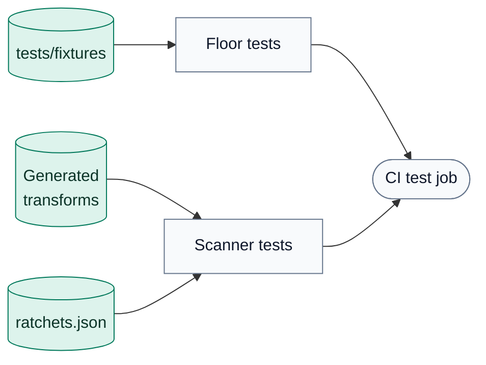

# Testing

Parity is scored by a corpus and a test that are not in this repository ([compat.md](compat.md)). The two tracks here, the floors and the scanners, run on every clone, and neither measures parity. The code map is [architecture.md](architecture.md), and what parity means is [parity.md](parity.md).

The floors read the committed fixtures, and the scanners read the generated tree against the ratchet file.



*Figure 1. L4 Detail -- Floors and scanners. Green is committed data.* Up: [L3 Components -- dfe-transform-elastic](architecture.md#four-steps-between-the-producers-and-the-sink).

The floors are `integration.rs`, `untested_sources.rs` and `unencumbered.rs`. The scanners are `painless_binding.rs`, `bespoke_registry.rs`, `grok_pattern_coverage.rs` and `skipped_processors.rs`, and `tests/ratchets.json` holds the counts they ratchet, such as `dead_branch_sites` and `skipped_processors`. `tests/compare-policy.yaml` is read through `dfe_runtime::testutil::policy` by the parity comparison.

## The fixtures

`tests/fixtures/` holds two sets, and `tests/fixtures/PROVENANCE.md` says where each comes from:

- `unencumbered/` -- log samples from CC0, MIT and Apache-2.0 projects, under their licences.
- `synthetic/` -- samples written for this repository, one file per log variant, each following the layout the product's maker publishes, with invented values.

Neither has expected output, so the floors assert what holds regardless: no panic, errors at or under each fixture's ceiling, and every event without an error gains a field. `untested_sources.rs` sets its floors per case. An event the pipeline's failure handler marks with `error.message` counts as an error. The Beats envelopes under `tests/envelopes/beats/` are written the same way as the synthetic set.

The fixture tests read the committed data with no variable to set, so they run whenever CI does:

```bash
cargo test -p dfe-transforms --test integration --test untested_sources \
  --test grok_capture_paths --test unencumbered
cargo test -p dfe-runtime --all-features --lib --test date_repro
cargo test --no-default-features --test envelope --test envelope_detection
```

`crates/dfe-transforms/tests/unencumbered.rs` fails when `tests/fixtures/` holds anything but `unencumbered/`, `synthetic/` and the provenance, or when any file there contains one of three marker strings: the paths of Elastic's two source repositories, or its licence's name.

The test diff helper's `MatchMode` is defined in `crates/dfe-runtime/src/testutil/diff.rs`:

| Mode | Use | Behaviour |
|---|---|---|
| `Exact` | Default | Field-for-field JSON match |
| `Semantic` | Against Elastic's output | Like `Exact`, skipping every path the compare policy excludes |
| `Subset` | Fields the Beats runtime sets | Expected is a subset of actual, extra fields allowed |

`tests/unicode.rs` runs every registered transform against seventeen samples: scripts, right-to-left text, combining marks, emoji and degenerate inputs such as a byte-order mark mid-string.

## Core and the shared broker

Core is every test, and it runs on every push that triggers CI: the unit tests, the floors and scanners above, `tests/broker.rs` and `tests/kafka_tls.rs` against a broker, and the memory tests (`tests/ndjson_fanout.rs`, `tests/asa_teardown.rs`) held to the deployment contract. No test here is `#[ignore]`d.

Nextest is required (`test.rust.nextest` in `.hyperi-ci.yaml`): the memory tests read the process's peak resident set and `tests/config_cascade.rs` reads scalo's process-wide cascade, so each needs a process to itself.

The Kafka tests share one broker per run, on the image scalo pins as `test_support::KAFKA_IMAGE`. The first test process starts it through scalo's `shared_kafka`, the rest join it by name, and it is removed when the run's nextest process exits, locally and in CI alike. The two tests that stop the broker or raise its record ceiling start one alone (`start_alone`), and `tests/kafka_tls.rs` starts scalo's `TlsBroker`. Each is removed when its test ends. A broker listed in `KAFKA_BROKERS` is used instead where one answers. Without Docker the tests skip locally and fail in CI.

The standard these follow is hyperi-ai's `standards/universal/testing.md`.
