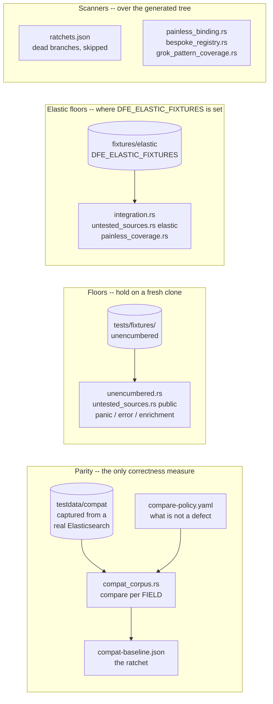

# Testing

The three test tracks -- the parity corpus, the fixture floors, the scanners over the generated
tree -- and the match modes and non-English sweeps they run under. The code map around them is
[architecture.md](architecture.md), what parity means is [parity.md](parity.md), and how the
corpus is produced is [compat.md](compat.md).

Three tracks, and only the first measures parity.



The corpus is GITIGNORED, so it exists only where it has been generated. Its absence makes
`compat_corpus.rs` pass, which is why a run outside the main tree needs `DFE_COMPAT_CORPUS`
pointed at one.

---

## Elastic test data

The pipeline-test fixtures and the Beats envelope shapes are copied from `elastic/integrations` and `elastic/beats`, which are Elastic License 2.0, so they are kept outside this repository, in a `fixtures/elastic/` directory. That directory is laid out like this repository's root, so `tests/fixtures/okta/system/` names the same fixture in both.

Every test that reads them is `#[ignore]`d here and reaches the data through `dfe_runtime::testutil::elastic_fixtures()`, which panics when `DFE_ELASTIC_FIXTURES` is unset or names no `tests/fixtures`. A run that asks for them therefore fails rather than passing on nothing:

```bash
export DFE_ELASTIC_FIXTURES=/path/to/fixtures/elastic
cargo test -p dfe-transforms --test integration --test untested_sources \
  --test painless_coverage --test grok_capture_paths -- --ignored
cargo test -p dfe-runtime --all-features --lib --test date_repro -- --ignored
cargo test --no-default-features --test envelope --test envelope_detection \
  -- --include-ignored
```

A CI job with access to that data runs those, plus the Python-tooling checks, against `main` on a schedule and on any change to the data. Only licence-clean samples go in `tests/fixtures/`, and `crates/dfe-transforms/tests/unencumbered.rs` fails on any file outside `unencumbered/`.

---

## Match modes

`crates/dfe-runtime/src/testutil/diff.rs` defines `MatchMode`:

| Mode | Use Case | Behaviour |
|---|---|---|
| **Exact** | Default | Field-for-field JSON match |
| **Semantic** | Non-deterministic fields | Ignore timestamps with "now", generated UUIDs, GeoIP, user agent |
| **Subset** | Fields set by Beats runtime | Expected is subset of actual (extra fields OK) |

---

## Non-English input

`tests/unicode.rs` runs every registered transform against seventeen scripts and a set of
degenerate inputs, so multi-byte and malformed text is a first-class case rather than an edge
case discovered in production.

## Core, full and the shared broker

Core is every test that is not `#[ignore]`d, and it runs on every push: the unit tests, the corpus and floors above, `tests/broker.rs` and `tests/kafka_tls.rs` against a real broker, and the memory tests (`tests/ndjson_fanout.rs`, `tests/asa_teardown.rs`) held to the deployment contract. Full adds the `#[ignore]`d ones, the tests that need `DFE_ELASTIC_FIXTURES` or a generated corpus, and a release runs it (`test.full.required_for_release`). Run full locally with `cargo nextest run --all-features --run-ignored all`.

Nextest is required (`test.rust.nextest`): the memory tests read the process's peak resident set and `tests/config_cascade.rs` reads scalo's process-wide cascade, so each needs a process of its own.

The Kafka tests share one broker per run, `apache/kafka:4.3.1@sha256:77e3df9054047a88b520d0cc46e16696d3b22022e1d580aeccd2632df6532837`, the image scalo pins as `test_support::KAFKA_IMAGE`. The first test process starts it through scalo's `shared_kafka`, the rest join it by name, and it is removed when the run's nextest process exits, locally and in CI alike. The two tests that stop the broker or raise its record ceiling start one alone (`start_alone`), and `tests/kafka_tls.rs` starts scalo's `TlsBroker`. Each is removed when its test ends. A live broker named in `KAFKA_BROKERS` is used instead where one answers. Without Docker the tests skip locally and fail in CI.

The standard these follow is hyperi-ai's `standards/universal/testing.md`.
