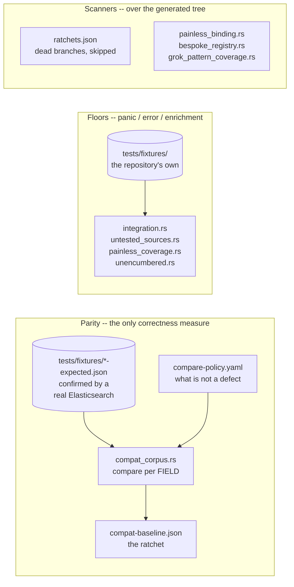

# Testing

The three test tracks -- the parity corpus, the fixture floors, the scanners over the generated
tree -- and the match modes and non-English sweeps they run under. The code map around them is
[architecture.md](architecture.md), what parity means is [parity.md](parity.md), and how the
corpus is produced is [compat.md](compat.md).

Three tracks, and only the first measures parity.



The confirmed documents are committed beside the fixtures, so every clone carries the parity
corpus and `compat_corpus.rs` fails rather than passing on none.

---

## The fixtures

The fixtures under `tests/fixtures/` are the repository's own: one directory per data stream,
holding sample lines, their test configs, and beside each sample the documents the real Elastic
engine produced for it. They are produced by the meta project that maintains the transforms,
and `tests/fixtures/PROVENANCE.md` says how. The Beats envelope shapes under
`tests/envelopes/beats/` are built the same way.

The fixture tests read this committed data with no variable to set, through
`dfe_runtime::testutil::fixtures()` and the envelope and unencumbered directories, so they run
whenever CI does:

```bash
cargo test -p dfe-transforms --test integration --test untested_sources \
  --test painless_coverage --test grok_capture_paths --test compat_corpus
cargo test -p dfe-runtime --all-features --lib --test date_repro
cargo test --no-default-features --test envelope --test envelope_detection
```

`tests/fixtures/unencumbered/` holds vendor samples under their own licences, and
`crates/dfe-transforms/tests/unencumbered.rs` fails on any fixture that names an Elastic
repository or licence.

---

## Match modes

`crates/dfe-runtime/src/testutil/diff.rs` defines `MatchMode`:

| Mode | Use Case | Behaviour |
|---|---|---|
| **Exact** | Default | Field-for-field JSON match |
| **Semantic** | Non-deterministic fields | Ignore timestamps with "now", generated UUIDs, GeoIP, user agent |
| **Subset** | Fields set by Beats runtime | Expected is subset of actual (extra fields OK) |

---

## Non-English input

`tests/unicode.rs` runs every registered transform against seventeen scripts and a set of
degenerate inputs, so multi-byte and malformed text is a first-class case rather than an edge
case discovered in production.

## Core, full and the shared broker

Core is every test, and it runs on every push that triggers CI: the unit tests, the corpus and floors above, `tests/broker.rs` and `tests/kafka_tls.rs` against a real broker, and the memory tests (`tests/ndjson_fanout.rs`, `tests/asa_teardown.rs`) held to the deployment contract. No test here is `#[ignore]`d.

Nextest is required (`test.rust.nextest`): the memory tests read the process's peak resident set and `tests/config_cascade.rs` reads scalo's process-wide cascade, so each needs a process of its own.

The Kafka tests share one broker per run, on the image scalo pins as `test_support::KAFKA_IMAGE`. The first test process starts it through scalo's `shared_kafka`, the rest join it by name, and it is removed when the run's nextest process exits, locally and in CI alike. The two tests that stop the broker or raise its record ceiling start one alone (`start_alone`), and `tests/kafka_tls.rs` starts scalo's `TlsBroker`. Each is removed when its test ends. A live broker named in `KAFKA_BROKERS` is used instead where one answers. Without Docker the tests skip locally and fail in CI.

The standard these follow is hyperi-ai's `standards/universal/testing.md`.
