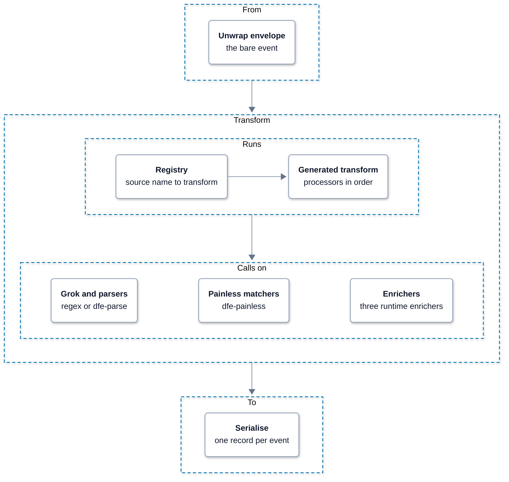
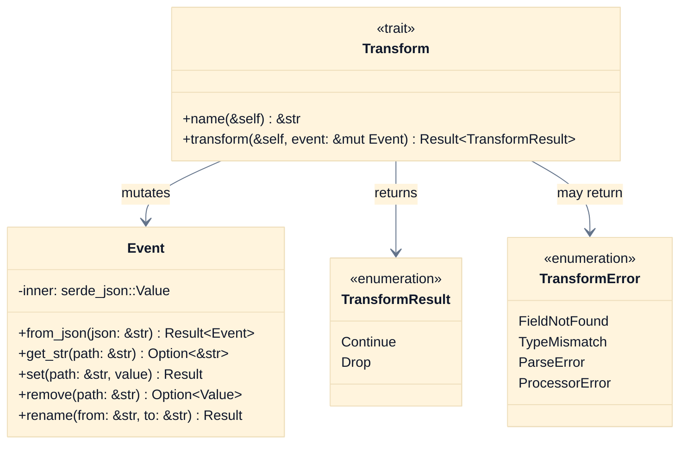
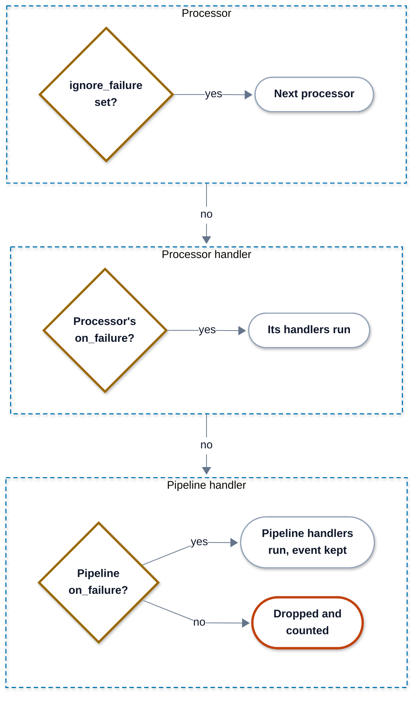

# Transform

Transform is the step in [dfe-transform-elastic](architecture.md) that runs a source's Elastic ingest pipeline on each event, as one generated Rust function.

| | |
|---|---|
| Repo | [hyperi-io/dfe-transform-elastic](https://github.com/hyperi-io/dfe-transform-elastic), `crates/dfe-transforms*`, `crates/dfe-runtime`, `crates/dfe-painless`, `crates/dfe-parse` and `src/registry.rs` |
| Image and chart | `ghcr.io/hyperi-io/dfe-transform-elastic`, and the thin chart each release assembles from `src/deployment.rs` |
| Config reference | `source.name`, `source.mode` and `geoip` in [config.example.yaml](../config.example.yaml) |
| Endpoints | None of its own |
| Metrics | `events_transformed_total`, `events_errored_total`, `events_dropped_total`, `painless_handled_total`, `painless_unhandled_total` on `:9090/metrics` |

The registry resolves the configured source name to one transform at startup, so nothing is looked up per event. `dfe-transform-elastic sources` lists every source a build has.



*Figure 1. L4 Detail -- Transform.* Up: [L3 Components -- dfe-transform-elastic](architecture.md). Down: [L4 Detail -- Grok dispatch](parsers.md), [L4 Detail -- Enrichers](enrichment.md).

## How it works

A generated transform is one function that runs its pipeline's processors in order, each behind its `if` condition. The `Transform` trait is object-safe, and the registry hands out `&'static dyn Transform`.

`Event` in `dfe-core` wraps a `serde_json::Value` with dotted-path access for ECS fields. `set()` creates intermediate objects. A read of a segment that is not a field falls back to a key with the dot inside it, and a numeric segment indexes an array, the way Elastic's templates read `{{_temp.user_parts.0}}`.

```rust
// Reads {"source": {"geo": {"city_name": ...}}}
event.get_str("source.geo.city_name")

// Creates {"source": {"geo": {}}} if missing, then sets city_name
event.set("source.geo.city_name", "Sydney")?;
```

In agentless mode a detector names each event's source from a marker table, runs that source's transform and stamps `_source` ([configuration.md](configuration.md#agentless-mode-serves-one-syslog-stream-of-many-device-types)).

## Interfaces

A transform mutates an `Event` in place and returns `Continue`, `Drop` or an error.



*Figure 2. L4 Detail -- Event and Transform types. The enumerations list the main variants, not all of them.* Up: [L4 Detail -- Transform](transform.md).

- The map under `serde_json::Value` is an `IndexMap`, because `preserve_order` is on. Elasticsearch's ingest documents keep insertion order, and parity rests on it.
- `Event::from_bytes` parses with `serde_json`, not simd-json. Getting a `serde_json::Value` out of simd-json builds two trees for one document, and `crates/dfe-runtime/benches/json_parse.rs` shows it slower.

## Scaling and failure

A failed processor is skipped, handled, or ends the pipeline. The event is lost when the pipeline has no handler.



*Figure 3. L4 Detail -- A failed processor. Dropped and counted is the event lost to the output.* Up: [L4 Detail -- Transform](transform.md).

| Elastic behaviour | Generated Rust |
|---|---|
| `if` | The processor runs inside `if _cond { ... }` |
| `ignore_failure: true` | The processor runs in a closure whose error is discarded |
| A processor's `on_failure` | Its handlers run with `_ingest.on_failure_message`, `_ingest.on_failure_processor_type` and `_ingest.on_failure_processor_tag` set, then cleared |
| The pipeline's `on_failure` | Its handlers run, and the event is emitted |
| No handler at all | The error leaves the transform, and `pipeline.rs` drops the event and counts it on `events_errored_total` |
| `drop` | The transform returns `TransformResult::Drop` |

Most Elastic pipelines declare a pipeline-level `on_failure` that sets `event.kind: pipeline_error`, appends to `error.message` and tags `preserve_original_event`, so the generated transform does the same.

## Key metrics

| Metric | Healthy when |
|---|---|
| `events_errored_total` | Flat. A rise is events no handler kept |
| `events_dropped_total` | Matches what the pipeline's `drop` processors mean to drop |
| `painless_unhandled_total` | Flat. Each is a script that was skipped |

## Related

- [parsers.md](parsers.md), the grok dispatch, every processor the transforms use and the Painless coverage
- [enrichment.md](enrichment.md), GeoIP, user agent and community ID
- [parity.md](parity.md), what the transform does in place of Elastic's ingest pipeline
- [performance.md](performance.md), the benchmarks and the libraries
